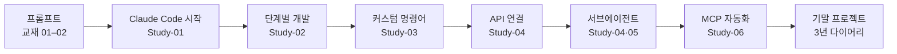
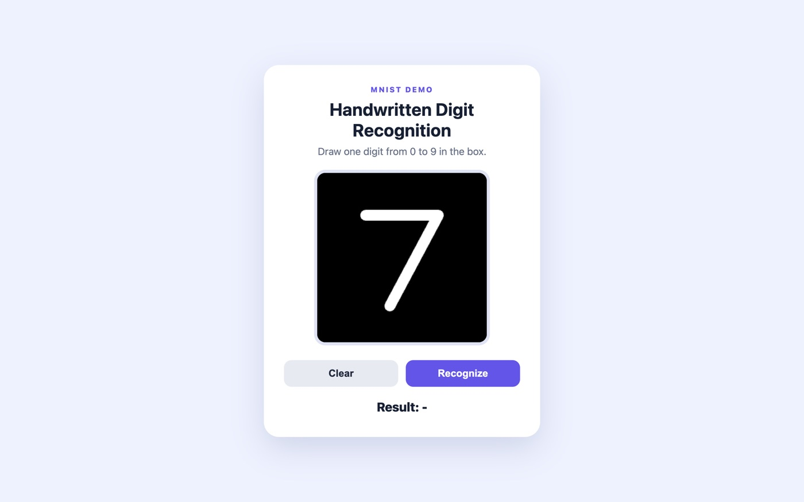
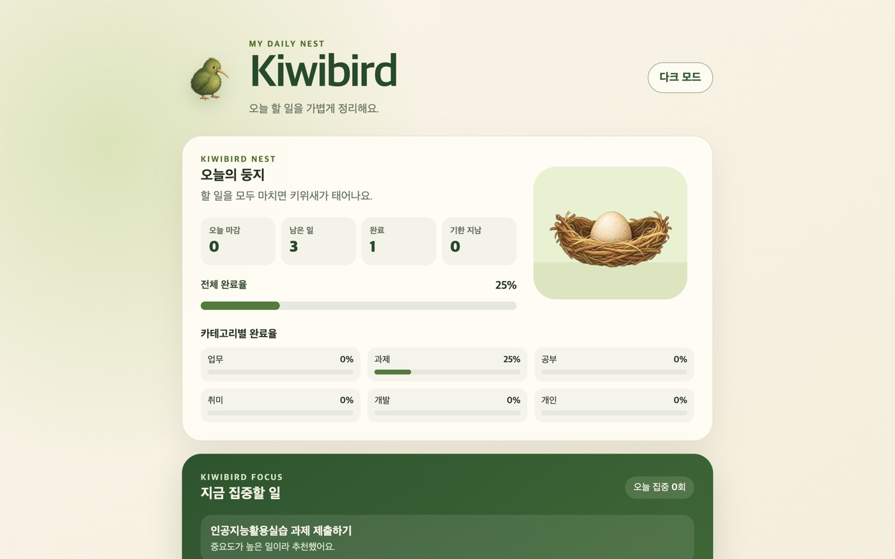
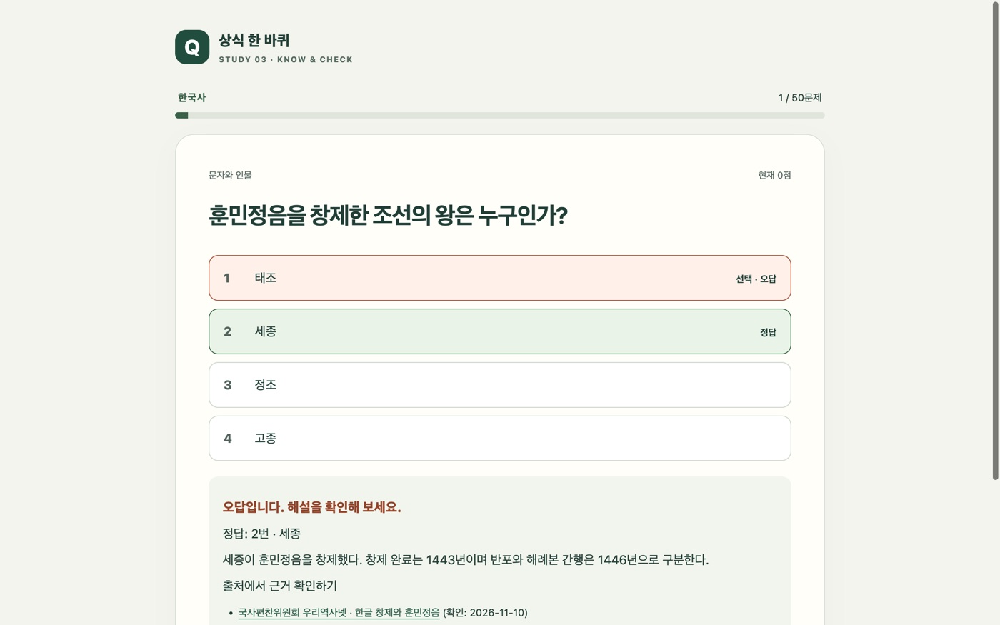
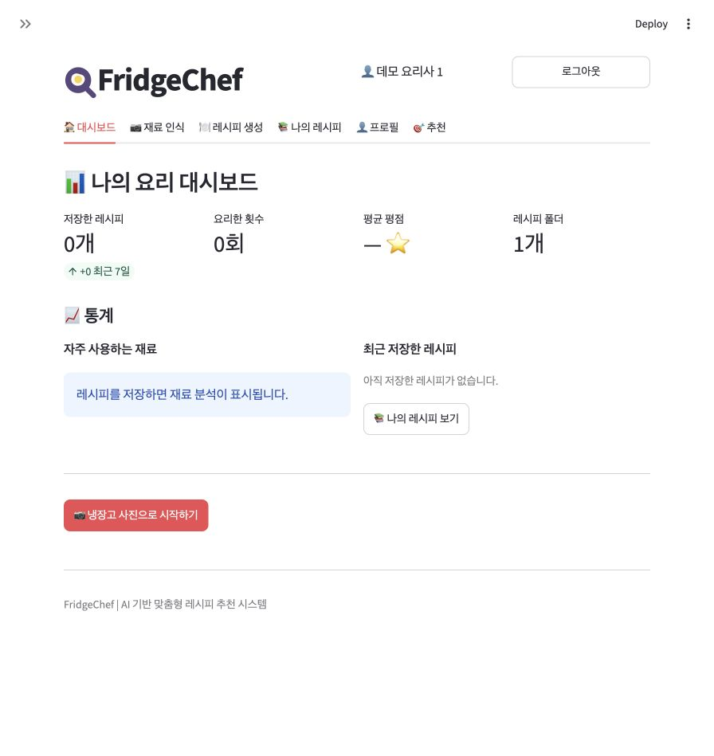

# 인공지능활용실습 — 한 학기 프로젝트 모음

> 국립목포대학교 **인공지능활용실습** 수업에서 AI 코딩 도구(Claude Code·Codex)와 함께 만든 결과물입니다.
> 손글씨 인식으로 시작해 API·에이전트·MCP를 차례로 익혔고, 기말 프로젝트 **3년 다이어리**로 마무리했습니다.

프로젝트 7개 · 교재 16장 실습 · 아래 순서는 수업 진행 순서입니다

---

## 📋 한눈에 보기

| # | 프로젝트 | 교재 | 핵심 실습 (AI 활용) | 바로 확인 |
| :---: | --- | :---: | --- | --- |
| 01 | 손글씨 숫자 인식 | 03 | Claude Code 설치, 첫 앱 만들기 | [README](Study-01/README.md) |
| 02 | Kiwibird 할 일 관리 | 04–06 | 단계별 프롬프트, `/compact`·`/resume`, 화면 캡처로 UI 개선 | [README](Study-02/README.md) · [▶ 실행](https://kiwisoop.github.io/ai-practice-course/Study-02/) |
| 03 | 상식 한 바퀴 퀴즈 | 07–09 | 출처 확인으로 할루시네이션 방지, 커스텀 명령어 10개 | [README](Study-03/README.md) · [▶ 실행](https://kiwisoop.github.io/ai-practice-course/Study-03/) |
| 04 | FridgeChef 냉장고 요리사 | 11–13 | API 키 관리, 3단계 PRD, 리뷰·최적화·UX 서브에이전트 | [README](Study-04/README.md) · [13주차 기록](Study-04/WEEK13.md) |
| 05 | 공감 다이어리 · PDF 요약 | 14 | 역할별 AI 개발팀 (서브에이전트 5개) | [README](Study-05/README.md) |
| 06 | 쇼핑 리스트 + MCP | 15–16 | Notion·Sequential Thinking·Context7·Playwright·GitHub MCP | [실행 기록](Study-06/claude-code-rerun/README.md) · [▶ 실행](https://kiwisoop.github.io/ai-practice-course/Study-06/claude-code-rerun/shopping-list.html) |
| ⭐ 07 | 기말 프로젝트 · 3년 다이어리 | — | AI 이야기·수채화·음성 내레이션 쇼츠 생성 | [same-day-diary 저장소](https://github.com/kiwisoop/same-day-diary) |

> **▶ 실행** 링크는 설치 없이 브라우저에서 바로 열립니다. 교재 10(Obsidian·Claudian)은 개인 볼트에서 진행해 결과 파일이 없습니다 — [교재별 실습 확인표](#교재별-실습-확인표) 참고.

---

## 한 학기 흐름



---

## 프로젝트

<table>
  <tr>
    <td width="50%" valign="top">
      <a href="Study-01/README.md"></a>
      <h3>01 · 손글씨 숫자 인식</h3>
      <sub>교재 03</sub>
      <p>숫자를 그리면 MNIST로 학습한 모델이 숫자와 신뢰도를 알려 줍니다. 데스크톱(Tkinter)과 웹 두 가지 버전이 있습니다.</p>
      <sub>🐍 Python · TensorFlow</sub>
    </td>
    <td width="50%" valign="top">
      <a href="Study-02/README.md"></a>
      <h3>02 · Kiwibird 할 일 관리</h3>
      <sub>교재 04–06</sub>
      <p>할 일을 모두 끝내면 둥지의 알이 키위새로 바뀝니다. 마감일·우선순위·집중 타이머·자동 분류를 지원합니다.</p>
      <sub>🌐 브라우저만 있으면 실행</sub><br>
      <a href="https://kiwisoop.github.io/ai-practice-course/Study-02/"><b>▶ 온라인으로 열기</b></a>
    </td>
  </tr>
  <tr>
    <td width="50%" valign="top">
      <a href="Study-03/README.md"></a>
      <h3>03 · 상식 한 바퀴 퀴즈</h3>
      <sub>교재 07–09</sub>
      <p>모든 문제에 출처가 붙은 50문제 퀴즈입니다. 커스텀 명령어 10개와 교사용 대시보드·보고서를 만들었습니다.</p>
      <sub>🌐 브라우저만 있으면 실행</sub><br>
      <a href="https://kiwisoop.github.io/ai-practice-course/Study-03/"><b>▶ 온라인으로 열기</b></a>
    </td>
    <td width="50%" valign="top">
      <a href="Study-04/README.md"></a>
      <h3>04 · FridgeChef 냉장고 요리사</h3>
      <sub>교재 11–13</sub>
      <p>냉장고 사진에서 재료를 인식하고 레시피를 추천합니다. 리뷰·최적화·UX 서브에이전트로 코드를 개선했습니다.</p>
      <sub>🐍 Python · Streamlit · 🔑 API 키</sub>
    </td>
  </tr>
  <tr>
    <td width="50%" valign="top">
      <a href="Study-05/README.md"></a>
      <h3>05 · 공감 다이어리 · PDF 요약</h3>
      <sub>교재 14</sub>
      <p>역할별 AI 개발팀(서브에이전트 5개)과 함께 일기 공감 앱과 PDF 요약 앱을 만들었습니다.</p>
      <sub>🐍 Python · pypdf · 🔑 API 키</sub>
    </td>
    <td width="50%" valign="top">
      <a href="Study-06/claude-code-rerun/README.md"></a>
      <h3>06 · 쇼핑 리스트 + MCP</h3>
      <sub>교재 15–16</sub>
      <p>Claude Code에 Notion·Sequential Thinking·Context7·Playwright·GitHub MCP를 설치해, 쇼핑 리스트 앱을 자동 검사하고 <a href="https://github.com/kiwisoop/shopping-list-app">별도 저장소</a>에 올렸습니다.</p>
      <sub>🌐 브라우저만 있으면 실행</sub><br>
      <a href="https://kiwisoop.github.io/ai-practice-course/Study-06/claude-code-rerun/shopping-list.html"><b>▶ 온라인으로 열기</b></a>
    </td>
  </tr>
</table>

### ⭐ 07 · 기말 프로젝트 · 3년 다이어리

기말 프로젝트는 별도 저장소로 분리했습니다.

**👉 [kiwisoop/same-day-diary](https://github.com/kiwisoop/same-day-diary)**: 같은 날짜의 일기를 3년 동안 쌓으면, AI가 일기를 짧은 이야기·수채화·목소리가 담긴 세로 쇼츠 영상으로 만들어 줍니다.

---

## 프로젝트별로 한 일

각 프로젝트에서 **무엇을 만들었고, AI를 어떻게 썼고, 무엇을 직접 확인했는지** 짧게 정리했습니다. 자세한 과정은 각 README에 있습니다.

### 01 · 손글씨 숫자 인식 (교재 03)
- **만든 것:** 숫자를 그리면 MNIST로 학습한 CNN 모델이 숫자와 신뢰도를 보여 주는 프로그램. Tkinter 데스크톱판을 먼저 만들고, 같은 모델을 쓰는 웹판으로 확장했습니다.
- **AI 활용:** 한 번에 완성을 요청하지 않고 "데스크톱 → 실행 환경 정리 → 웹 확장" 순서로 나누어 요청했습니다. 프로젝트 규칙을 `AGENTS.md`에 남겨 다음 작업에서도 같은 방식을 이어 갔습니다.
- **직접 확인:** 가상환경을 만들고 테스트 2개(이미지 전처리·빈 화면 오류 안내)를 실행했습니다. 웹판에서도 예측 결과가 나오는지 확인했습니다.

### 02 · Kiwibird 할 일 관리 (교재 04–06)
- **만든 것:** 할 일을 모두 끝내면 둥지의 알이 키위새로 바뀌는 할 일 관리 앱. 카테고리·마감일·중요도, 검색·필터, 다크 모드, 집중 타이머, JSON 백업을 넣고 5주차에 자동 분류를 추가했습니다.
- **AI 활용:** `PRD.md`로 요구사항을 먼저 정하고, `PROMPTS.md`의 5단계로 나누어 하나씩 구현했습니다. 교재 06에서는 첫 버전의 화면 캡처를 AI에게 보여 주고 UI를 개선했으며, 첫 버전은 [`web_version/`](Study-02/web_version/README.md)에 그대로 보관했습니다.
- **직접 확인:** 단계마다 브라우저에서 동작을 확인했습니다. 빈 둥지 → 알 → 키위새 → 완료 취소 시 알로 돌아가는 상태 전환을 반복해서 점검했습니다.

### 03 · 상식 한 바퀴 퀴즈 (교재 07–09)
- **만든 것:** 모든 문제에 정답·해설·출처가 붙은 50문제 4지선다 퀴즈. 이후 스피드·분야별·오늘의 퀴즈 모드와, 학생 기록을 모아 CSV·HTML로 내보내는 교사용 보고서를 추가했습니다.
- **AI 활용:** AI가 만든 문제를 그대로 쓰지 않고 출처 본문과 대조해 할루시네이션을 걸렀습니다([출처 검토 기록](Study-03/SOURCE_REVIEW.md)). 반복 작업은 [커스텀 명령어 10개](Study-03/.claude/commands)(문제 추가·검증·통계·보고서 등)로 만들었습니다.
- **직접 확인:** 데이터·채점 자동 검사(`check.js`)와 Chrome 화면 검사를 거쳤습니다. 키보드 조작과 모바일 너비(320px)도 확인했습니다.

### 04 · FridgeChef 냉장고 요리사 (교재 11–13)
- **만든 것:** 냉장고 사진에서 재료를 인식하고, 조건에 맞는 레시피를 생성해 사용자별로 저장하는 Streamlit 앱. 로그인, 대시보드, 폴더·평점 관리 기능이 있습니다.
- **AI 활용:** 교재 12의 3단계 PRD(이미지 인식 → 레시피 생성 → 저장)대로 나누어 개발했습니다. 교재 13에서는 리뷰 → 성능 최적화 → UX 개선 서브에이전트에 차례로 맡겨 버그 3건을 찾아 고쳤습니다([13주차 기록](Study-04/WEEK13.md)).
- **직접 확인:** 학교 API 주소 문제를 찾아 실제 인증까지 확인했습니다. 수정 전 백업을 남겼고, 자동 테스트 13개가 통과했습니다. API 키는 `.env`에만 두고 저장소에는 올리지 않았습니다.

### 05 · 공감 다이어리 · PDF 요약 (교재 14)
- **만든 것:** 일기를 쓰면 감정과 공감 메시지를 돌려주는 다이어리, PDF 글을 추출해 일반·간단 요약을 만드는 앱. 두 앱이 로컬 Python 서버 하나를 같이 씁니다.
- **AI 활용:** 기획·백엔드·프런트엔드·QA·AI 통합 역할의 서브에이전트 5개로 "AI 개발팀"을 꾸려 역할을 나누어 개발했습니다.
- **직접 확인:** 모의 API와 임시 PDF로 서버·프런트엔드 테스트를 실행했습니다. API 키는 화면 메모리에만 두고 서버나 로그에 남기지 않도록 했습니다.

### 06 · 쇼핑 리스트 + MCP (교재 15–16)
- **만든 것:** 추가·체크·삭제가 되는 쇼핑 리스트 앱과 Notion 페이지 3개(Claude Code 업데이트 요약, 체류 시간 늘리기 일반 구상·체계적 구상), 그리고 [shopping-list-app](https://github.com/kiwisoop/shopping-list-app) 저장소.
- **AI 활용:** Claude Code에 MCP 5개를 직접 설치하고 교재 프롬프트를 그대로 입력했습니다. Playwright MCP로 앱을 자동 테스트하고, Sequential Thinking으로 7단계 구상을 한 뒤 Notion에 저장했으며, GitHub MCP로 저장소를 만들어 올렸습니다.
- **직접 확인:** 실제로 호출된 도구와 횟수를 기록했고, 막혔던 문제 4가지와 해결 방법을 정리했습니다([실행 기록](Study-06/claude-code-rerun/README.md)).

### ⭐ 07 · 기말 프로젝트 · 3년 다이어리
- **만든 것:** 같은 날짜의 일기를 3년 동안 모아 보는 다이어리. AI가 일기를 짧은 이야기·수채화 이미지·음성 내레이션이 담긴 세로 쇼츠 영상으로 만들어 줍니다.
- 자세한 내용은 별도 저장소 [kiwisoop/same-day-diary](https://github.com/kiwisoop/same-day-diary)에 있습니다.

---

## 교재별 실습 확인표

| 교재 | 실습 내용 | 결과물 |
| :---: | --- | --- |
| 01 | AI 어시스턴트와 바이브 코딩 | 웹 채팅 실습 (파일 없음) |
| 02 | 좋은 프롬프트·PRD 쓰기 | 각 Study의 `PRD.md`에 적용 |
| 03 | Claude Code 설치, 손글씨 인식 | [Study-01](Study-01/README.md) |
| 04 | `/init`·`/model` 등 단계별 프롬프트 | [Study-02](Study-02/README.md) |
| 05 | `/compact`·`/resume`, 자동 분류 | [Study-02](Study-02/README.md) |
| 06 | 화면 캡처로 UI 개선, 이전 버전 보관 | [Study-02/web_version](Study-02/web_version/README.md) |
| 07 | 출처 확인으로 할루시네이션 막기 | [Study-03 출처 검토](Study-03/SOURCE_REVIEW.md) |
| 08 | 커스텀 명령어 만들기 | [Study-03 명령어](Study-03/.claude/commands) |
| 09 | 명령어 체이닝·상대평가 보고서·CSV | [Study-03 확장 기능](Study-03/EXTENSIONS.md) · [report_detailed.csv](Study-03/report_detailed.csv) |
| 10 | Obsidian·Claudian | 플러그인 설치·연결 확인 (개인 볼트) |
| 11 | API 키 설정·`.gitignore` | [Study-04](Study-04/README.md) |
| 12 | 3단계 PRD로 API 앱 만들기 | [Study-04](Study-04/README.md) |
| 13 | 리뷰·최적화·UX 서브에이전트 | [Study-04 13주차 기록](Study-04/WEEK13.md) |
| 14 | AI 개발팀으로 앱 2개 만들기 | [Study-05](Study-05/README.md) |
| 15 | Notion·Sequential Thinking MCP | [Claude Code 실행 기록](Study-06/claude-code-rerun/README.md) (Notion 페이지 3개) |
| 16 | Context7·Playwright·GitHub MCP | [Claude Code 실행 기록](Study-06/claude-code-rerun/README.md) · [shopping-list-app](https://github.com/kiwisoop/shopping-list-app) |

<details>
<summary>교재와 다르게 진행한 부분</summary>

- **도구:** 교재는 Claude Code 기준이지만 일부 실습은 Codex와 함께 했습니다. 작업 규칙은 `AGENTS.md`에 있고, 각 폴더의 `CLAUDE.md`가 이를 불러옵니다.
- **API:** 교재의 OpenRouter 대신 학교에서 제공한 API 게이트웨이를 사용했습니다.
- **교재 09:** 보고서 예시는 가상 학생 10명의 기록(`examples/sample-records.json`)으로 만들었습니다.
- **교재 15·16:** 처음에는 Codex에 연결된 도구로 대신했다가, 이후 Claude Code에 MCP를 직접 설치해 교재 프롬프트 그대로 다시 했습니다([실행 기록](Study-06/claude-code-rerun/README.md)). 처음 버전은 Study-06 README에 남겨 두었습니다.

</details>

---

## 실행 방법

| 필요한 것 | 프로젝트 |
| --- | --- |
| 브라우저만 | Study-02 · Study-03 · Study-06 · 기말 시연판 |
| Python | Study-01 |
| Python + 본인 API 키 | Study-04 · Study-05 · 기말 프로젝트 전체 기능 (음성 내레이션은 음성 모델을 따로 설치하면 사용) |

설치 순서는 각 프로젝트 README의 **실행 방법**에 있습니다. API 키는 `.env`에만 저장하며 저장소에는 올리지 않습니다.

## 폴더 구성

```text
ai-practice-course/
├── Study-01/      손글씨 숫자 인식
├── Study-02/      Kiwibird 할 일 관리
├── Study-03/      출처 확인 퀴즈 + 커스텀 명령어
├── Study-04/      FridgeChef + 서브에이전트
├── Study-05/      공감 다이어리 · PDF 요약
├── Study-06/      쇼핑 리스트 + MCP
└── docs/images/   README용 화면 캡처
```
