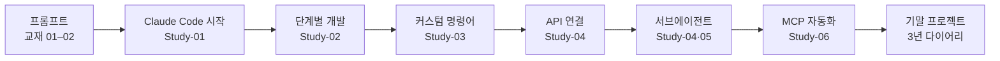
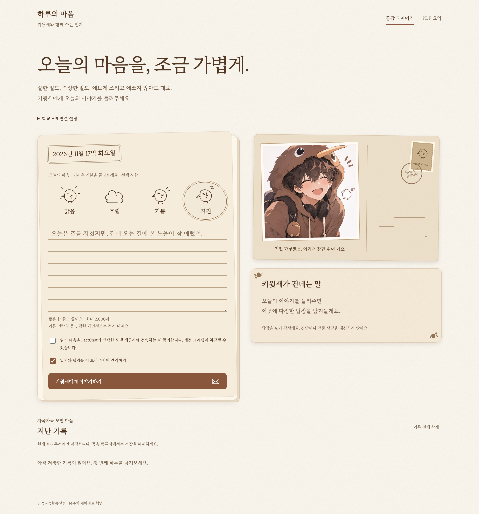
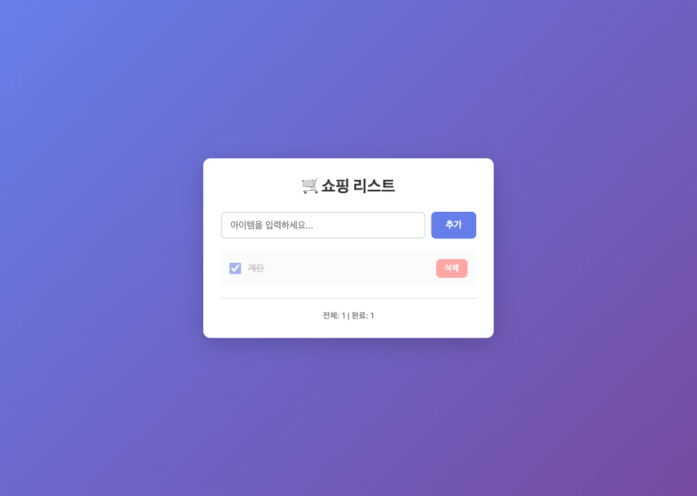

# 인공지능활용실습 — 한 학기 프로젝트 모음

> 국립목포대학교 **인공지능활용실습** 수업에서 AI 코딩 도구(Claude Code·Codex)와 함께 만든 결과물입니다.
> 손글씨 인식으로 시작해 API·에이전트·MCP를 차례로 익혔고, 기말 프로젝트 **3년 다이어리**로 마무리했습니다.

프로젝트 7개 · 교재 16장 실습 · 아래 순서는 수업 진행 순서입니다

---

## 한 학기 흐름



---

## 프로젝트

<table>
  <tr>
    <td width="50%" valign="top">
      <a href="Study-01/README.md"></a>
      <h3>01 · 손글씨 숫자 인식</h3>
      <sub>교재 03</sub>
      <p>숫자를 그리면 MNIST로 학습한 모델이 숫자와 신뢰도를 알려 줍니다. 데스크톱(Tkinter)과 웹 두 가지 버전이 있습니다.</p>
      <sub>🐍 Python · TensorFlow</sub>
    </td>
    <td width="50%" valign="top">
      <a href="Study-02/README.md"></a>
      <h3>02 · Kiwibird 할 일 관리</h3>
      <sub>교재 04–06</sub>
      <p>할 일을 모두 끝내면 둥지의 알이 키위새로 바뀝니다. 마감일·우선순위·집중 타이머·자동 분류를 지원합니다.</p>
      <sub>🌐 브라우저만 있으면 실행</sub>
    </td>
  </tr>
  <tr>
    <td width="50%" valign="top">
      <a href="Study-03/README.md"></a>
      <h3>03 · 상식 한 바퀴 퀴즈</h3>
      <sub>교재 07–09</sub>
      <p>모든 문제에 출처가 붙은 50문제 퀴즈입니다. 커스텀 명령어 8개와 교사용 대시보드·보고서를 만들었습니다.</p>
      <sub>🌐 브라우저만 있으면 실행</sub>
    </td>
    <td width="50%" valign="top">
      <a href="Study-04/README.md"></a>
      <h3>04 · FridgeChef 냉장고 요리사</h3>
      <sub>교재 11–13</sub>
      <p>냉장고 사진에서 재료를 인식하고 레시피를 추천합니다. 리뷰·최적화·UX 서브에이전트로 코드를 개선했습니다.</p>
      <sub>🐍 Python · Streamlit · 🔑 API 키</sub>
    </td>
  </tr>
  <tr>
    <td width="50%" valign="top">
      <a href="Study-05/README.md"></a>
      <h3>05 · 공감 다이어리 · PDF 요약</h3>
      <sub>교재 14</sub>
      <p>역할별 AI 개발팀(서브에이전트 5개)과 함께 일기 공감 앱과 PDF 요약 앱을 만들었습니다.</p>
      <sub>🐍 Python · pypdf · 🔑 API 키</sub>
    </td>
    <td width="50%" valign="top">
      <a href="Study-06/claude-code-rerun/README.md"></a>
      <h3>06 · 쇼핑 리스트 + MCP</h3>
      <sub>교재 15–16</sub>
      <p>Claude Code에 Notion·Sequential Thinking·Context7·Playwright·GitHub MCP를 설치해, 쇼핑 리스트 앱을 자동 검사하고 <a href="https://github.com/kiwisoop/shopping-list-app">별도 저장소</a>에 올렸습니다.</p>
      <sub>🌐 브라우저만 있으면 실행</sub>
    </td>
  </tr>
</table>

### ⭐ 07 · 기말 프로젝트 · 3년 다이어리

<a href="Term-Project/README.md"></a>

<table>
  <tr>
    <td width="34%"></td>
    <td valign="top">
      <h3><a href="Term-Project/README.md">같은 날, 세 해의 이야기</a></h3>
      <p>같은 날짜의 일기를 3년 동안 쌓으면, AI가 일기를 <b>짧은 이야기 · 수채화 · 세로 쇼츠 영상</b>으로 만들어 줍니다.</p>
      <ul>
        <li>학교 API로 Claude가 이야기를 쓰고 GPT Image가 수채화를 그립니다</li>
        <li>FFmpeg로 자막·배경음악을 넣어 720×1280 세로 영상을 합성합니다</li>
        <li>호출 전에 동의와 예상 비용을 확인하고, 같은 일기는 이전 결과를 다시 씁니다</li>
      </ul>
      <p><a href="https://kiwisoop.github.io/ai-practice-course/Term-Project/"><b>▶ 온라인 시연판</b></a>: API를 호출하지 않고 미리 만든 결과로 체험합니다</p>
    </td>
  </tr>
</table>

---

## 교재별 실습 확인표

| 교재 | 실습 내용 | 결과물 |
| :---: | --- | --- |
| 01 | AI 어시스턴트와 바이브 코딩 | 웹 채팅 실습 (파일 없음) |
| 02 | 좋은 프롬프트·PRD 쓰기 | 각 Study의 `PRD.md`에 적용 |
| 03 | Claude Code 설치, 손글씨 인식 | [Study-01](Study-01/README.md) |
| 04 | `/init`·`/model` 등 단계별 프롬프트 | [Study-02](Study-02/README.md) |
| 05 | `/compact`·`/resume`, 자동 분류 | [Study-02](Study-02/README.md) |
| 06 | 화면 캡처로 UI 개선, 이전 버전 보관 | [Study-02/web_version](Study-02/web_version/README.md) |
| 07 | 출처 확인으로 할루시네이션 막기 | [Study-03 출처 검토](Study-03/SOURCE_REVIEW.md) |
| 08 | 커스텀 명령어 만들기 | [Study-03 명령어](Study-03/.claude/commands) |
| 09 | 명령어 체이닝·상대평가 보고서·CSV | [Study-03 확장 기능](Study-03/EXTENSIONS.md) · [report_detailed.csv](Study-03/report_detailed.csv) |
| 10 | Obsidian·Claudian | 플러그인 설치·연결 확인까지 (개인 볼트) |
| 11 | API 키 설정·`.gitignore` | [Study-04](Study-04/README.md) |
| 12 | 3단계 PRD로 API 앱 만들기 | [Study-04](Study-04/README.md) |
| 13 | 리뷰·최적화·UX 서브에이전트 | [Study-04 13주차 기록](Study-04/WEEK13.md) |
| 14 | AI 개발팀으로 앱 2개 만들기 | [Study-05](Study-05/README.md) |
| 15 | Notion·Sequential Thinking MCP | [Claude Code 실행 기록](Study-06/claude-code-rerun/README.md) (Notion 페이지 3개) |
| 16 | Context7·Playwright·GitHub MCP | [Claude Code 실행 기록](Study-06/claude-code-rerun/README.md) · [shopping-list-app](https://github.com/kiwisoop/shopping-list-app) |

<details>
<summary>교재와 다르게 진행한 부분</summary>

- **도구:** 교재는 Claude Code 기준이지만 일부 실습은 Codex와 함께 했습니다. 작업 규칙은 `AGENTS.md`에 있고, 각 폴더의 `CLAUDE.md`가 이를 불러옵니다.
- **API:** 교재의 OpenRouter 대신 학교에서 제공한 API 게이트웨이를 사용했습니다.
- **교재 09:** 보고서 예시는 가상 학생 10명의 기록(`examples/sample-records.json`)으로 만들었습니다.
- **교재 10:** Claudian 플러그인 설치와 연결 확인까지 했습니다. 공고 분석 노트·발표 슬라이드 예제는 저장소에 기록이 없습니다.
- **교재 15·16:** 처음에는 Codex에 연결된 도구로 대신했다가, 이후 Claude Code에 MCP를 직접 설치해 교재 프롬프트 그대로 다시 했습니다([실행 기록](Study-06/claude-code-rerun/README.md)). 처음 버전은 Study-06 README에 남겨 두었습니다.

</details>

---

## 실행 방법

| 필요한 것 | 프로젝트 |
| --- | --- |
| 브라우저만 | Study-02 · Study-03 · Study-06 · 기말 시연판 |
| Python | Study-01 |
| Python + 본인 API 키 | Study-04 · Study-05 · 기말 프로젝트 전체 기능 |

설치 순서는 각 프로젝트 README의 **실행 방법**에 있습니다. API 키는 `.env`에만 저장하며 저장소에는 올리지 않습니다.

## 폴더 구성

```text
ai-practice-course/
├── Study-01/      손글씨 숫자 인식
├── Study-02/      Kiwibird 할 일 관리
├── Study-03/      출처 확인 퀴즈 + 커스텀 명령어
├── Study-04/      FridgeChef + 서브에이전트
├── Study-05/      공감 다이어리 · PDF 요약
├── Study-06/      쇼핑 리스트 + MCP
├── Term-Project/  기말 프로젝트 · 3년 다이어리
└── docs/images/   README용 화면 캡처
```
