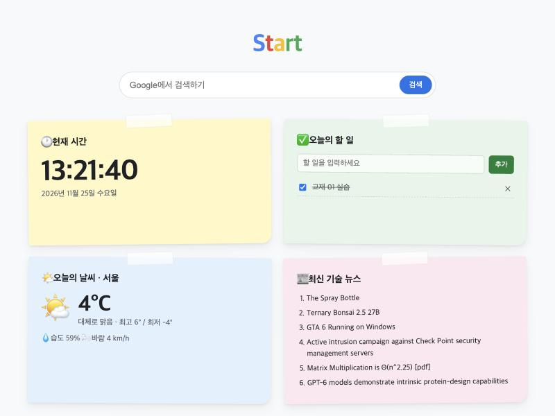
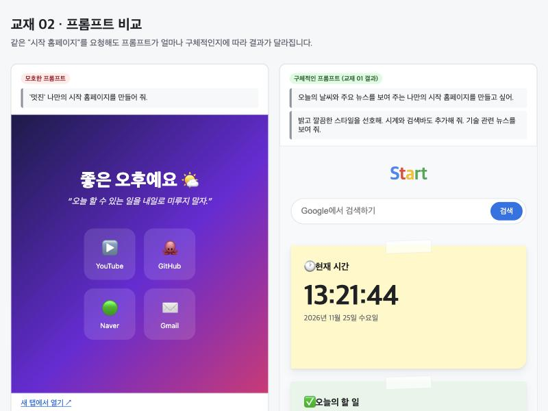
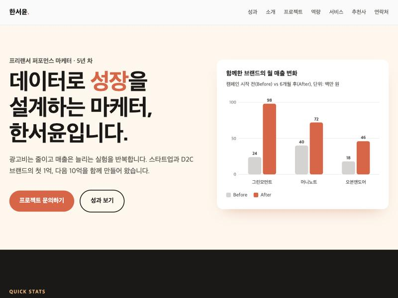

# 교재 01·02 — AI로 웹페이지 만들기와 프롬프트 활용

교재 01 「AI 어시스턴트」와 교재 02 「프롬프트 활용」의 웹페이지 실습 결과입니다. 결과물은 세 가지입니다.

| 결과물 | 교재 | 내용 | 바로 보기 |
| --- | :---: | --- | --- |
| [시작 홈페이지](01-start-page/index.html) | 01 | 시계·검색창·오늘의 할 일·서울 날씨·기술 뉴스가 메모지 카드에 담긴 시작 페이지 | [▶ 실행](https://kiwisoop.github.io/ai-practice-course/Study-00/01-start-page/) |
| [프롬프트 비교](02-prompt-compare/index.html) | 02 | 모호한 프롬프트와 구체적인 프롬프트의 결과를 나란히 비교 | [▶ 실행](https://kiwisoop.github.io/ai-practice-course/Study-00/02-prompt-compare/) |
| [마케팅 포트폴리오](02-portfolio/index.html) | 02 | PRD → 5단계 프롬프트 → 뼈대·기능·디자인·점검으로 만든 프리랜서 마케터 포트폴리오 | [▶ 실행](https://kiwisoop.github.io/ai-practice-course/Study-00/02-portfolio/) |

> **진행 방식:** 교재는 claude.ai의 **아티팩트** 화면에서 진행합니다. 이 결과물은 2026-11-25에 **Claude Code**에서 교재 프롬프트를 같은 순서로 입력해 HTML 파일로 만들었습니다. 교재의 [게시] 단계는 GitHub Pages 링크(위 ▶ 실행)로 대신했습니다.

## 1. 교재 01 · 시작 홈페이지



교재 프롬프트를 순서대로 반영했습니다.

| 순서 | 교재 프롬프트 | 반영 결과 |
| :---: | --- | --- |
| 1 | 오늘 날씨와 주요 뉴스를 보여 주는 나만의 시작 홈페이지를 만들고 싶어. | 날씨·뉴스 영역 |
| 2 | 밝고 깔끔한 스타일을 선호해. 시계와 검색바도 추가해 줘. 기술 관련 뉴스를 보여 줘. | 밝은 배경, 시계, 검색창, 기술 뉴스 |
| 3 | 이 계획대로 시작해 줘. | 첫 완성본 |
| 4 | 구글 스타일로 디자인을 수정해 줘. | 구글 색 로고와 둥근 검색창 |
| 5 | 오늘의 할 일 목록을 추가해 줘. | 할 일 추가·체크·삭제, 브라우저에 저장 |
| 6 | [현재 시간], [오늘의 할 일], [오늘의 날씨], [최신 기술 뉴스] 아이템을 한 열에 두 개씩 배치하고, 메모지 안에 각각 들어 있는 디자인으로 수정해 줘. | 2열 메모지 카드 배치 |

- **실제 데이터:** 날씨는 [Open-Meteo](https://open-meteo.com/)(서울), 뉴스는 Hacker News 인기 글을 불러옵니다. 둘 다 API 키가 필요 없습니다.
- **검색:** 입력한 검색어로 새 탭에서 Google 검색 결과를 엽니다.

## 2. 교재 02 · 프롬프트 비교



| | 프롬프트 | 결과 |
| --- | --- | --- |
| 모호함 | '멋진' 나만의 시작 홈페이지를 만들어 줘. | [vague.html](02-prompt-compare/vague.html): "멋지다"를 AI가 임의로 해석해 어두운 그라데이션·명언·즐겨찾기 화면이 나옴 |
| 구체적 | 오늘의 날씨와 주요 뉴스를 보여 주는… + 밝고 깔끔한 스타일, 시계와 검색바, 기술 뉴스 | 교재 01의 시작 홈페이지: 요청한 기능이 모두 들어감 |

비교 페이지에서 두 결과를 나란히 보고 무엇이 달라졌는지 표로 정리했습니다.

## 3. 교재 02 · 마케팅 포트폴리오



| 단계 | 한 일 | 자료 |
| --- | --- | --- |
| 기획 | 기본 질문 템플릿(5W1H)으로 PRD 작성 | [PRD.md](02-portfolio/PRD.md) |
| 프롬프트 | PRD를 5단계 프롬프트로 변환 | [PROMPTS.md](02-portfolio/PROMPTS.md) |
| ① 뼈대 | 섹션 8개에 고유 id 부여, 구조만 작성 → 프로젝트 수를 3년 성과 목록으로, Before/After 지표를 첫 화면 차트로 이동 | [steps/1-skeleton.html](02-portfolio/steps/1-skeleton.html) |
| ② 기능 | 가상 페르소나의 경력·프로젝트·추천사로 내용 채움 | [index.html](02-portfolio/index.html) |
| ③ 디자인 | 워드프레스 포트폴리오 테마 스타일 참고, 섹션별 색 톤 구분 | 〃 |
| ④ 점검 | 링크·PRD 대조 검사 → 개선점 3가지 발견·수정 | [PROMPTS.md의 점검 기록](02-portfolio/PROMPTS.md) |

**점검에서 발견하고 고친 3가지:** 모바일에서 메뉴가 사라짐, 모바일에서 차트 글자가 8px로 작아짐, 프로젝트 카드가 좁아 목록이 여러 번 줄바꿈됨.

> 포트폴리오의 인물(한서윤)·브랜드·수치·추천사는 모두 **실습용 가상 정보**입니다. 이메일은 예시 주소(`example.com`)입니다.

## 실행과 확인

설치 없이 각 `index.html`을 브라우저에서 엽니다. 시작 홈페이지의 날씨·뉴스는 인터넷 연결이 필요합니다.

2026-11-25에 로컬 서버(`python3 -m http.server`)로 세 페이지를 열어 확인했습니다.

- **시작 홈페이지:** 날씨·뉴스 실제 응답 표시. 할 일 추가, 빈 입력 거부, HTML 문자열을 글자 그대로 표시, 체크, 삭제, 새로고침 후 유지를 확인했습니다.
- **모바일 375px:** 시작 홈페이지와 포트폴리오 모두 가로 넘침이 없습니다. 모바일에서 시계가 두 줄로 넘어가는 문제를 발견해 `13:21:40` 형식으로 고쳤습니다.
- **포트폴리오:** 내부 링크 13개 모두 정상입니다.
- **콘솔 오류:** 세 페이지 모두 없습니다.

## 파일 구조

```text
Study-00/
├── 01-start-page/index.html       # 교재 01 시작 홈페이지
├── 02-prompt-compare/
│   ├── index.html                 # 모호한 vs 구체적인 프롬프트 비교
│   └── vague.html                 # 모호한 프롬프트의 결과
├── 02-portfolio/
│   ├── PRD.md                     # 5W1H 기본 질문 템플릿으로 쓴 기획서
│   ├── PROMPTS.md                 # 5단계 프롬프트와 4단계 진행·점검 기록
│   ├── steps/1-skeleton.html      # ① 뼈대 단계 결과
│   └── index.html                 # 완성된 포트폴리오
└── screenshots/                   # 실행 화면
```

---

[📸 실행 화면 보기](./SCREENSHOTS.md) · [전체 과제 목록으로 돌아가기](../README.md)
