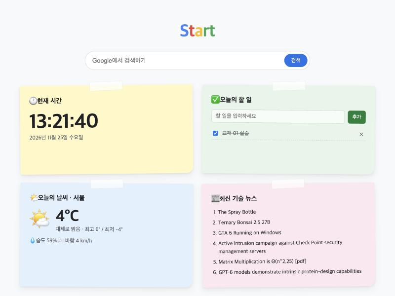
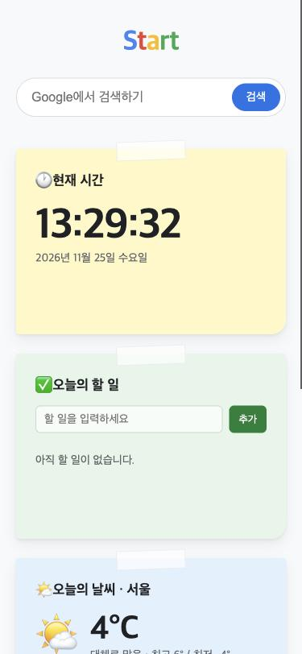
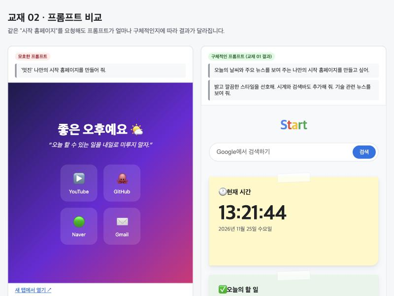
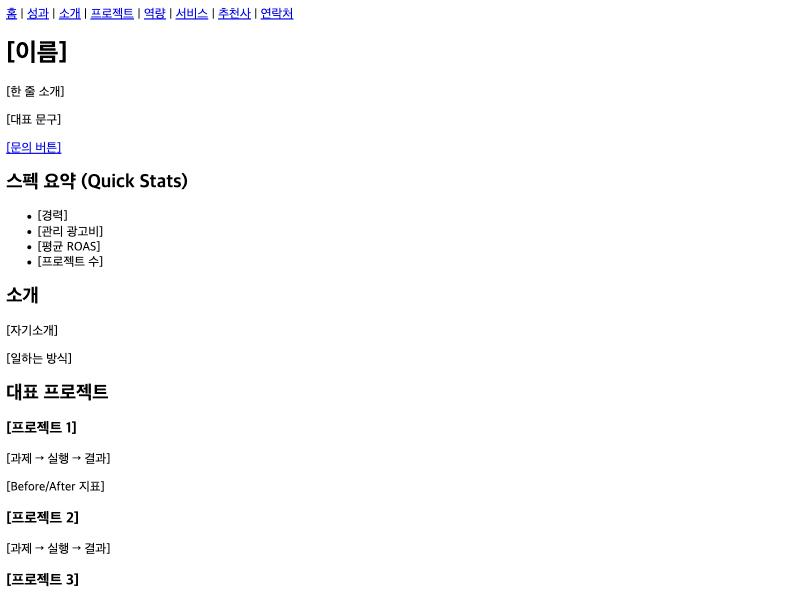
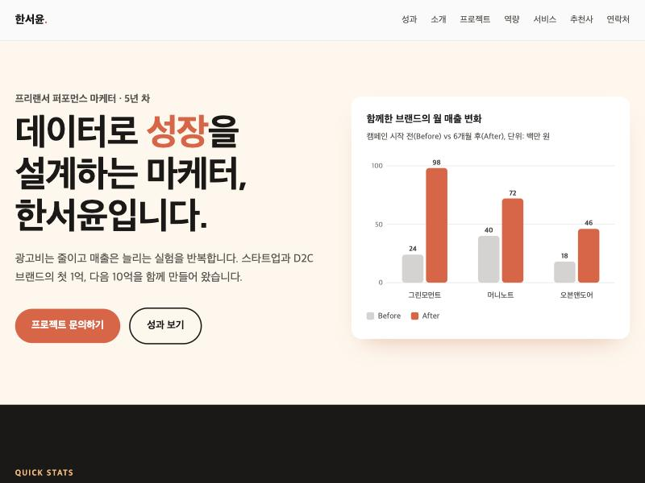
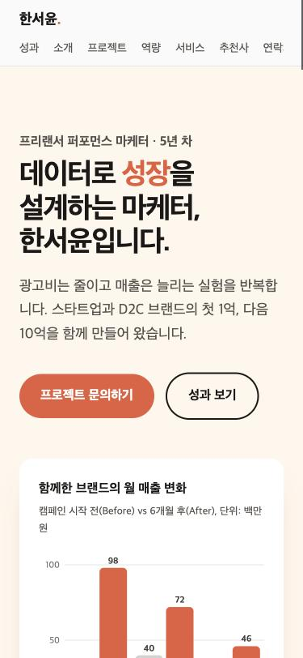

[전체 갤러리로](../SCREENSHOTS.md) · [다음: Study-01 손글씨 숫자 인식 →](../Study-01/SCREENSHOTS.md)

# 🌐 Study-00 · 시작 홈페이지 · 마케팅 포트폴리오

교재 01·02의 프롬프트를 순서대로 입력해 만든 웹페이지 세 가지입니다.

## 한눈에 보기

| 항목 | 내용 |
| --- | --- |
| 분류 | 🌐 웹 · 교재 01–02 |
| 하는 일 | 시계·검색·할 일·날씨·뉴스를 모은 시작 페이지, 모호한/구체적 프롬프트 비교, PRD로 만든 포트폴리오 |
| 기술 | HTML, CSS, Vanilla JS, localStorage, Open-Meteo·Hacker News API |
| 실행 방법 | [▶ 시작 홈페이지](https://kiwisoop.github.io/ai-practice-course/Study-00/01-start-page/) · [▶ 프롬프트 비교](https://kiwisoop.github.io/ai-practice-course/Study-00/02-prompt-compare/) · [▶ 포트폴리오](https://kiwisoop.github.io/ai-practice-course/Study-00/02-portfolio/) |
| 자세한 설명 | [README.md](./README.md) |

### 주요 기능

- **시작 홈페이지:** 실시간 시계, Google 검색, 브라우저에 저장되는 할 일, 서울 날씨, 기술 뉴스를 메모지 카드 2열로 배치
- **프롬프트 비교:** 같은 요청을 모호하게/구체적으로 했을 때의 결과를 나란히 보여 주고 차이를 표로 정리
- **마케팅 포트폴리오:** 5W1H로 쓴 PRD → 5단계 프롬프트 → 뼈대·기능·디자인·점검 순서로 완성

## 화면 보기

### 1. 시작 홈페이지 (교재 01)

시계·검색창·오늘의 할 일·날씨·뉴스가 메모지 카드에 담겨 있습니다. 날씨와 뉴스는 실제 데이터를 불러옵니다.

### 2. 시작 홈페이지 · 모바일 (375px)

좁은 화면에서는 카드가 한 열로 바뀝니다. 시계가 두 줄로 넘어가던 문제를 `13:29:32` 형식으로 고쳤습니다.

### 3. 프롬프트 비교 (교재 02)

왼쪽은 "멋진 시작 홈페이지"라는 모호한 요청의 결과, 오른쪽은 기능과 스타일을 구체적으로 적은 요청의 결과입니다.

### 4. 포트폴리오 ① 뼈대 단계

첫 프롬프트로 기능과 디자인 없이 섹션 구조와 고유 id만 만든 결과입니다.

### 5. 포트폴리오 완성본

가상 인물(한서윤)의 내용을 채우고 디자인을 입힌 최종 화면입니다. 첫 화면에 Before/After 매출 차트를 넣었습니다.

### 6. 포트폴리오 · 모바일 (375px)

점검 단계에서 찾은 문제(모바일 메뉴 사라짐, 차트 글자 8px)를 고친 뒤의 화면입니다. 메뉴는 가로로 스크롤됩니다.

> 촬영일 2026-11-25 · 로컬 서버(`python3 -m http.server`)에서 실행해 캡처했습니다. 포트폴리오의 인물·수치는 실습용 가상 정보입니다.

---

[전체 갤러리로](../SCREENSHOTS.md) · [다음: Study-01 손글씨 숫자 인식 →](../Study-01/SCREENSHOTS.md)
