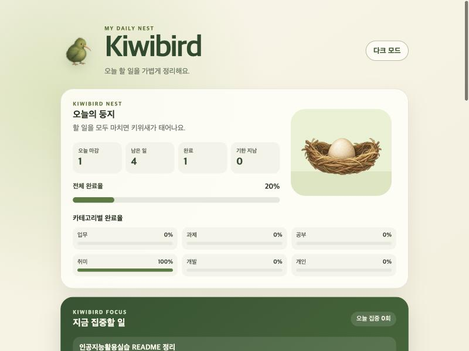
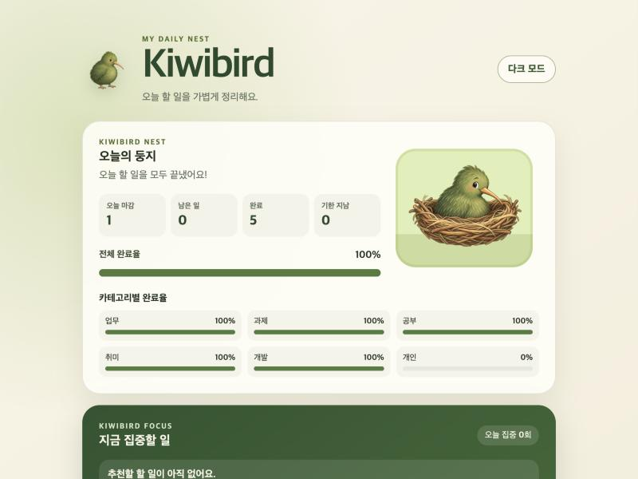
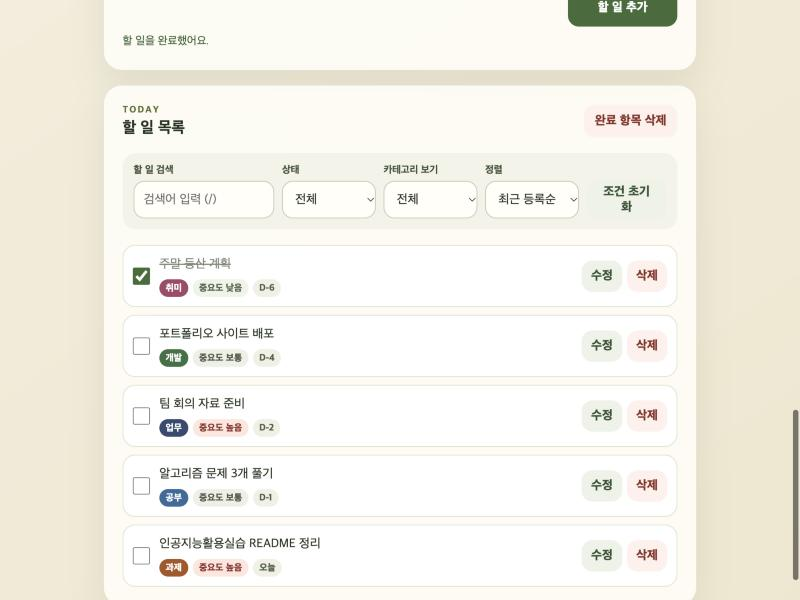
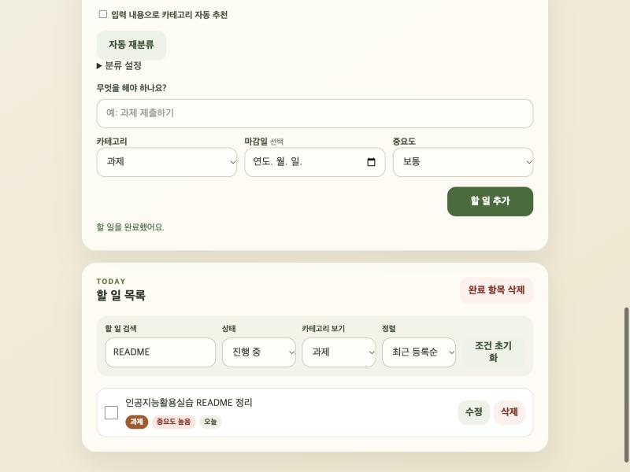
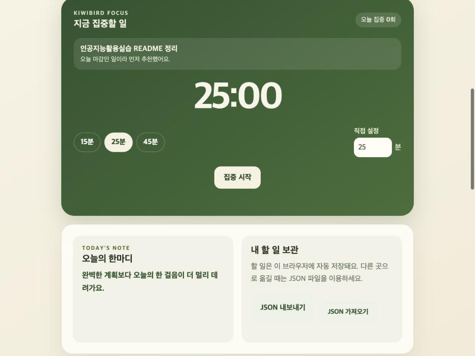
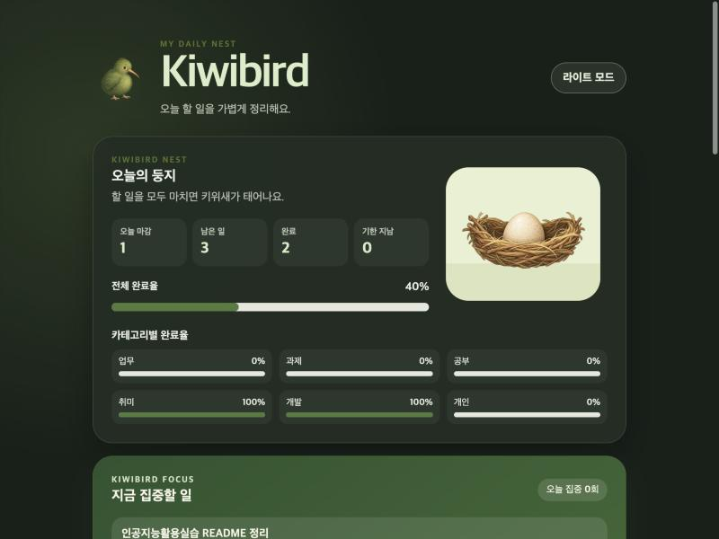
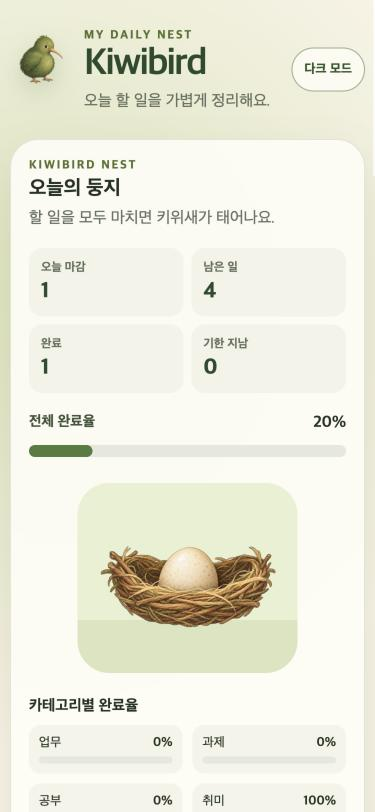
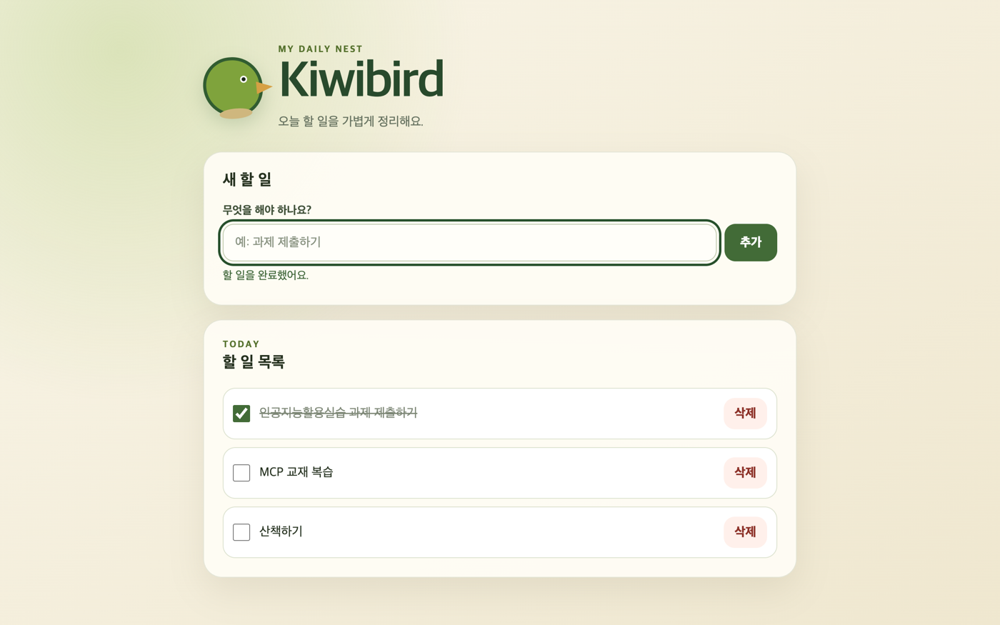

[← Study-01 손글씨 숫자 인식](../Study-01/SCREENSHOTS.md) · [전체 갤러리로](../SCREENSHOTS.md) · [다음: Study-03 상식 한 바퀴 퀴즈 →](../Study-03/SCREENSHOTS.md)

# 🥝 Study-02 · Kiwibird 할 일 관리

할 일이 생기면 둥지에 알이 나타나고, 모두 끝내면 알 대신 키위새를 만나는 개인용 할 일 관리 앱입니다.

## 한눈에 보기

| 항목 | 내용 |
| --- | --- |
| 분류 | 🌐 웹 · 교재 04–06 |
| 하는 일 | 할 일 추가·수정·완료·삭제, 카테고리 자동 추천, 완료율 대시보드, 집중 타이머 |
| 기술 | HTML, CSS, Vanilla JS, localStorage, JSON 백업 |
| 실행 방법 | [▶ 온라인으로 열기](https://kiwisoop.github.io/ai-practice-course/Study-02/) · 로컬은 `index.html` 더블 클릭 |
| 자세한 설명 | [README.md](./README.md) |

### 주요 기능

- 업무·과제·공부·취미·개발·개인 카테고리와 입력 키워드로 카테고리 자동 추천
- 마감일·중요도, 검색, 상태·카테고리 필터와 정렬
- 빈 둥지 → 알이 있는 둥지 → 키위새가 있는 둥지로 진행 상태 표현
- 우선순위에 맞는 할 일을 골라 주는 `Kiwibird Focus`와 집중 타이머
- 라이트·다크 모드, 브라우저 자동 저장, JSON 내보내기·가져오기, 반응형 화면

## 화면 보기

### 1. 메인 대시보드

할 일을 등록하면 둥지에 알이 생기고, 전체·카테고리별 완료율이 표시됩니다.

### 2. 모두 완료했을 때

등록한 일을 전부 끝내면 완료율 100%와 함께 알 대신 키위새가 나타납니다.

### 3. 할 일 목록

카테고리·마감일·중요도가 함께 보이고, 각 항목에서 완료·수정·삭제를 합니다.

### 4. 검색과 필터

검색어 `README`, 상태 `진행 중`, 카테고리 `과제`를 함께 적용한 결과입니다.

### 5. Kiwibird Focus 집중 타이머

우선순위가 높은 할 일을 추천하고, 15·25·45분 또는 직접 정한 시간으로 타이머를 실행합니다.

### 6. 다크 모드

### 7. 모바일 (375px)

### 8. 첫 버전 (교재 06 개선 전)

교재 06에서 이 캡처를 AI에게 보여 주고 UI를 개선했습니다. 첫 버전 코드는 [`web_version/`](./web_version/)에 보관했습니다.

> 촬영일 2026-11-25 (1–7번) · 로컬 서버에서 실행해 캡처했습니다. 8번은 과제 진행 중(4주차)에 캡처한 첫 버전 화면입니다.

---

[← Study-01 손글씨 숫자 인식](../Study-01/SCREENSHOTS.md) · [전체 갤러리로](../SCREENSHOTS.md) · [다음: Study-03 상식 한 바퀴 퀴즈 →](../Study-03/SCREENSHOTS.md)
