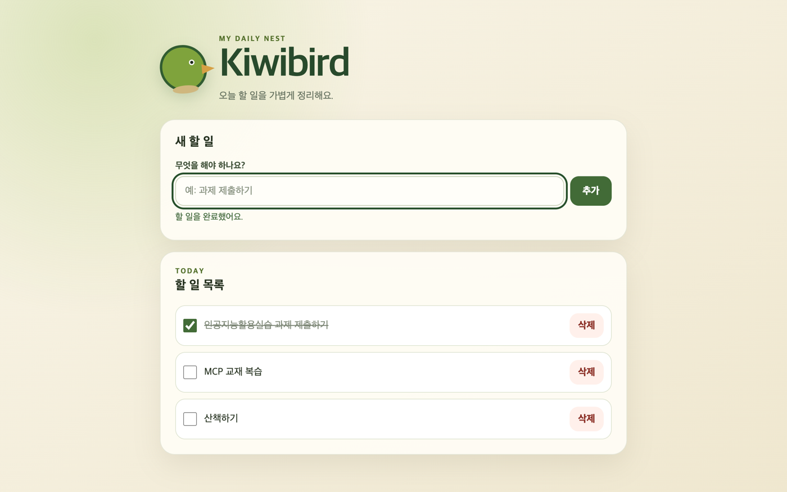
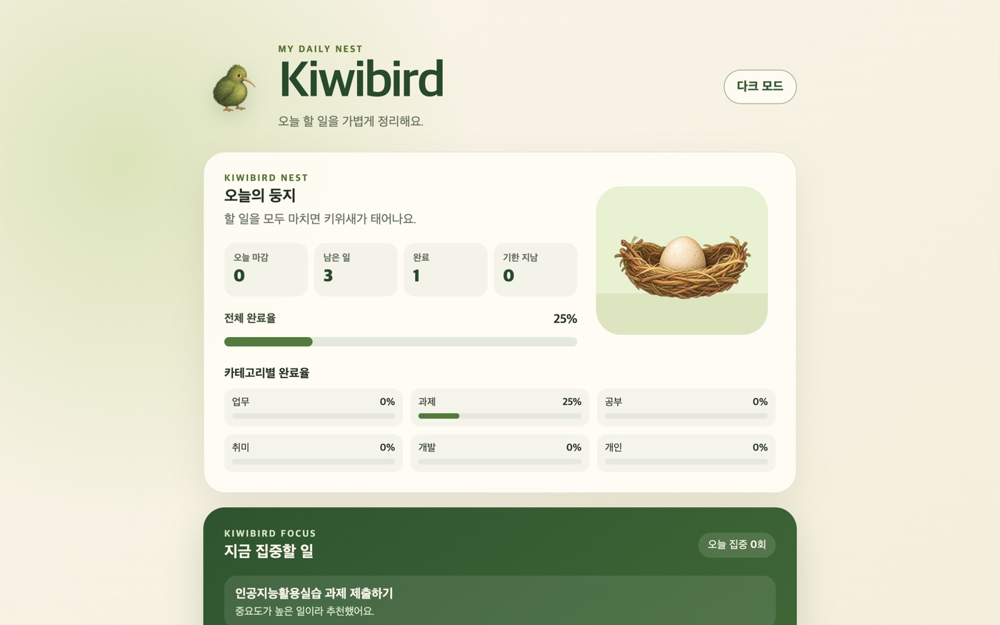

# web_version — 첫 버전 보관

교재 06 「프로젝트 개선과 작업 관리」 실습에서 화면을 개선하기 전에 **이전 결과를 따로 보관**하는 폴더다.

- 이 폴더의 `index.html`·`script.js`·`styles.css`는 Kiwibird의 첫 작동 버전(커밋 `6103072`, 2026-09-22)이다.
- 할 일 추가·완료·삭제만 있는 단순한 한 줄 목록 구성이다. 저장 기능이 없어 새로고침하면 목록이 사라진다.
- 이 화면을 캡처한 [`../화면캡처.png`](../화면캡처.png)를 AI에 전달해, 상위 폴더의 현재 버전(둥지 대시보드·집중 타이머·카테고리 등)으로 개선했다.

| 첫 버전 (이 폴더) | 현재 버전 (상위 폴더) |
| --- | --- |
|  |  |

`index.html`을 브라우저에서 열면 바로 실행된다.
