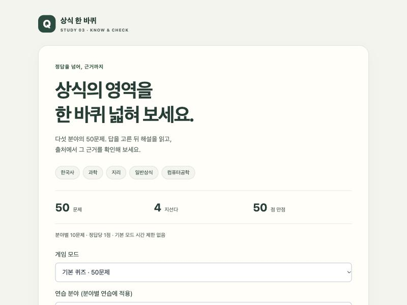
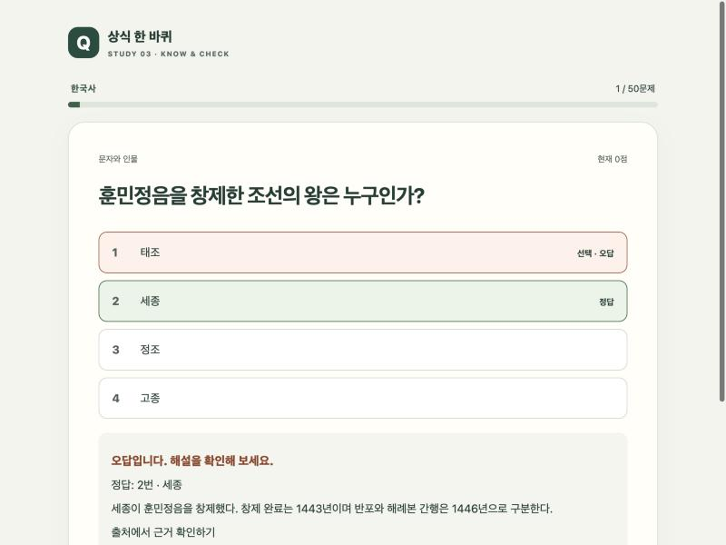
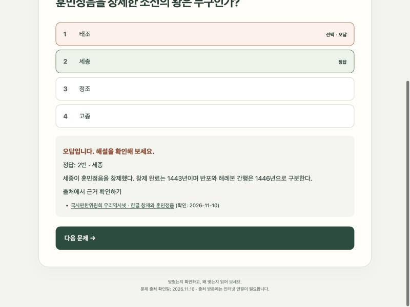
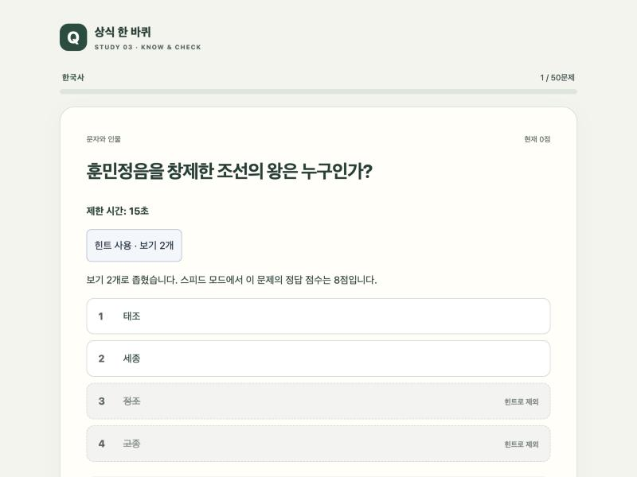
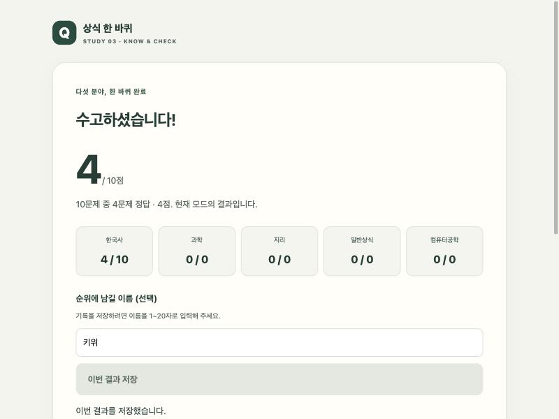
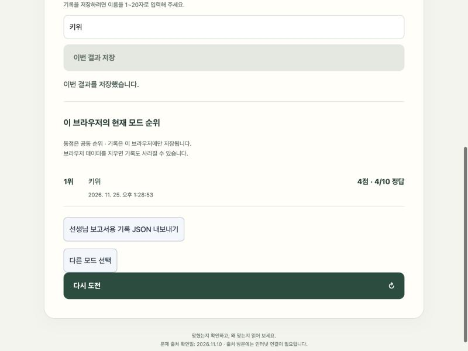
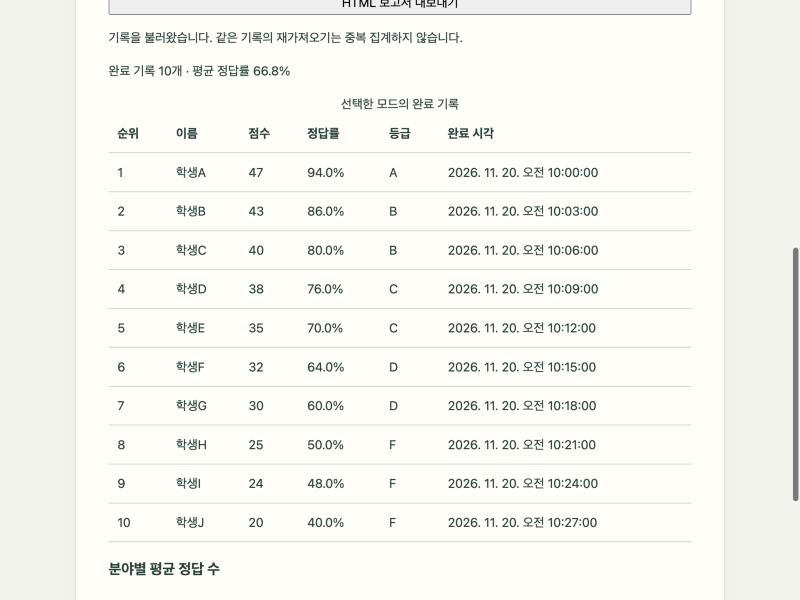
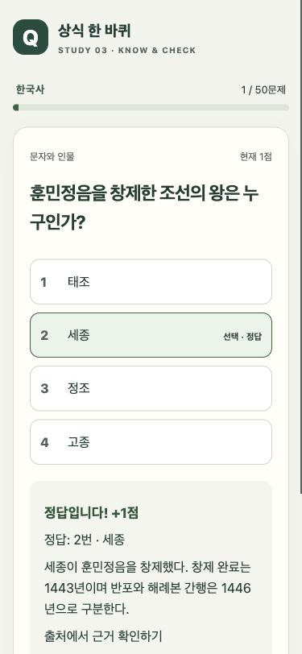

[← Study-02 Kiwibird 할 일 관리](../Study-02/SCREENSHOTS.md) · [전체 갤러리로](../SCREENSHOTS.md) · [다음: Study-04 FridgeChef →](../Study-04/SCREENSHOTS.md)

# 🧠 Study-03 · 상식 한 바퀴 퀴즈

모든 문제에 출처가 붙은 50문제 4지선다 퀴즈입니다. 답을 고르면 정답·해설과 함께 근거 출처가 표시됩니다.

## 한눈에 보기

| 항목 | 내용 |
| --- | --- |
| 분류 | 🌐 웹 · 교재 07–09 |
| 하는 일 | 한국사·과학·지리·일반상식·컴퓨터공학 각 10문제, 4개 모드, 순위 저장, 교사용 보고서 |
| 기술 | HTML, CSS, Vanilla JS, localStorage, Python 데이터 도구, Node.js 검사 도구 |
| 실행 방법 | [▶ 온라인으로 열기](https://kiwisoop.github.io/ai-practice-course/Study-03/) · 로컬은 `index.html`, 교사 대시보드는 `teacher_report.html` |
| 자세한 설명 | [README.md](./README.md) |

### 주요 기능

- 정답·오답 피드백, 올바른 정답과 해설·출처 표시 (출처 본문과 대조해 할루시네이션 제거)
- 기본 50문제·스피드(15초 타이머·힌트)·분야별 연습·오늘의 퀴즈 4개 모드
- 총점과 분야별 점수, 이름을 입력해 저장하는 공동 순위
- 교사 대시보드의 순위·평균·학습용 등급과 CSV/HTML 보고서
- 문제 추가 → 검사 → 통계를 잇는 커스텀 명령어 10개

## 화면 보기

### 1. 시작 화면

모드를 고르고 퀴즈를 시작합니다.

### 2. 문제 풀이와 오답 피드백

답을 고르면 바로 정답 여부가 표시되고, 틀렸을 때는 올바른 정답을 알려 줍니다.

### 3. 해설과 출처

모든 문제에 해설과 근거 출처 링크가 붙어 있습니다.

### 4. 스피드 모드 · 힌트

문제당 15초 타이머가 돌고, 힌트를 쓰면 오답 보기 2개가 점선·취소선과 "힌트로 제외" 표시로 비활성화됩니다.

### 5. 결과 화면

분야별 연습 모드를 마친 결과(10문제 중 4점)와 분야별 점수입니다.

### 6. 순위

이름을 입력해 저장한 기록이 높은 점수순으로 표시됩니다. 동점은 공동 순위입니다.

### 7. 교사 대시보드

예시 기록(학생 10명)을 불러와 순위·평균·학습용 등급을 확인하고 CSV/HTML 보고서를 내보냅니다.

### 8. 모바일 (375px)

> 촬영일 2026-11-25 · 로컬 서버에서 실행해 캡처했습니다. 7번은 `examples/`의 예시 기록을 사용했습니다.

---

[← Study-02 Kiwibird 할 일 관리](../Study-02/SCREENSHOTS.md) · [전체 갤러리로](../SCREENSHOTS.md) · [다음: Study-04 FridgeChef →](../Study-04/SCREENSHOTS.md)
