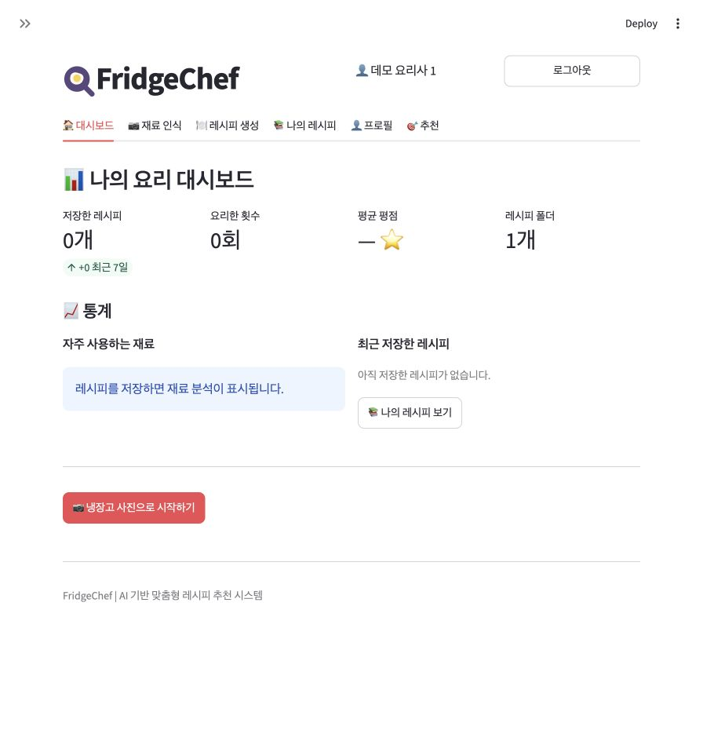
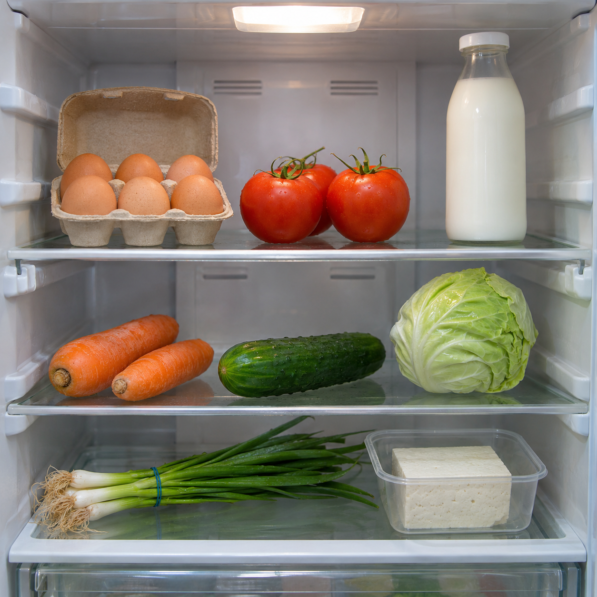

# 12주차 — FridgeChef: 냉장고 재료 인식·레시피 추천

교재의 3단계 흐름을 구현한 Python·Streamlit 앱이다. 학교용 FactChat Gateway를 사용한다.

## 프로젝트 한눈에 보기

| 항목 | 내용 |
| --- | --- |
| 과제 | 인공지능활용실습 12주차 · API 활용 |
| 목적 | 냉장고 속 재료를 확인하고 만들 수 있는 요리를 찾아 보관 |
| 사용자 흐름 | 로그인 → 대시보드 → 사진 인식 → 재료 수정 → 레시피 생성 → 저장 |
| 주요 기술 | Python, Streamlit, Pillow, SQLite, 학교용 FactChat Gateway |
| 준비물 | Python 환경, 식재료 사진 또는 재료 목록, 이용자 본인의 유효한 API 키 |
| 데이터 저장 | 현재 실행 환경의 SQLite. 키·원본 사진은 파일로 저장하지 않음 |

## 주요 기능

- **재료 인식:** 사진 업로드와 미리보기, 확인된 재료·불확실한 재료 구분
- **맞춤 레시피:** 재료 편집, 난이도·시간·인분·요리 종류·식단 제한 설정
- **결과 확인:** 재료·분량·조리법·예상 시간·추정 칼로리, 검색·필터·JSON 내보내기
- **개인 보관함:** 레시피 저장, 폴더 이동, 중복 저장 방지, 확인 후 삭제
- **프로필·대시보드:** 요리 취향, 평점·완료 횟수, 보유 재료 통계와 추천
- **계정:** 이메일로 만든 로컬 실습 계정 또는 공개 데모 계정



[로그인 화면](screenshots/login.jpg) · [재료 인식 화면](screenshots/ingredients.jpg) · [레시피 설정 화면](screenshots/recipes.jpg)

## 실행

Git으로 내려받는 경우 다음 명령으로 프로젝트 폴더에 이동한다. ZIP으로 내려받았다면 압축을 풀고 `Study-04` 폴더에서 터미널을 연다.

```sh
git clone https://github.com/kiwisoop/ai-practice-course.git
cd ai-practice-course/Study-04
```

### macOS·Linux

처음 설치할 때:

Python 3.12를 권장한다.

```sh
python3 -m venv .venv
.venv/bin/python -m pip install -r requirements.txt
```

Study-04 폴더에서 실행:

```sh
.venv/bin/python -m streamlit run app.py --server.address 127.0.0.1
```

### Windows

`Study-04` 폴더에서 다음 명령을 실행한다.

```powershell
py -3.12 -m venv .venv
.venv\Scripts\python.exe -m pip install -r requirements.txt
.venv\Scripts\python.exe -m streamlit run app.py --server.address 127.0.0.1
```

브라우저에서 http://127.0.0.1:8501 에 접속한다. 서버는 터미널을 열어 둔 동안 실행되며, `Ctrl+C`로 종료한다. 운영체제별 명령 안내가 모든 환경에서의 실행 검증을 의미하지는 않는다.

## 테스트용 냉장고 사진

사진을 따로 준비하지 않아도 아래 샘플로 재료 인식 기능을 테스트할 수 있다.

**[냉장고 샘플 사진 다운로드](https://raw.githubusercontent.com/kiwisoop/ai-practice-course/main/Study-04/assets/fridge-sample.png)**

링크를 열어 이미지를 저장하거나, 저장소를 내려받았다면 `assets/fridge-sample.png`를 사용한다.

1. 앱에서 로그인하고 본인의 학교 API 키와 사진 인식 모델을 설정한다.
2. **재료 인식** 탭에서 샘플 사진을 업로드한다.
3. 전송 안내를 확인한 뒤 **재료 인식 시작**을 누른다.
4. 인식 결과를 사진과 비교하고, **레시피 생성**으로 이어서 테스트한다.



이 사진은 실습을 위해 AI로 생성한 샘플이며 교재 원본 사진과는 다르다. 모델에 따라 인식 결과가 달라질 수 있다.

## 실습 순서

1. **로그인**: [데모 계정] 버튼을 누르거나 `demo@example.com / demo1234`로 로그인한다. 두 번째 테스트 계정은 `demo2@example.com / demo1234`이다. 회원가입 탭에서 실습용 로컬 계정을 만들 수도 있다. 비밀번호는 무작위 salt를 붙인 PBKDF2 해시로 저장하며 운영 서비스용 인증은 아니다. 로그인하면 대시보드가 먼저 열린다.
2. **API 설정**: 왼쪽 위 화살표로 사이드바를 열고 [API 연결 설정]에 키를 직접 입력한 뒤 [API 연결 테스트]를 누른다. 사진 인식용 Claude와 레시피 생성용 텍스트 모델을 각각 선택하고 전송 안내를 확인한다. DeepSeek가 계정에 제공되면 선택할 수 있고 Claude로도 생성할 수 있다.
3. **재료 인식**: `assets/fridge-sample.png`, LMS의 `냉장고.jpg` 또는 직접 촬영한 JPG·PNG 사진을 올린다. 전송 동의 후 [재료 인식 시작]을 누른다.
4. **레시피 생성**: 상단 탭 또는 [이 재료로 레시피 생성]으로 이동한다. [사용 가능한 재료 보기]에서 재료를 편집하고, 난이도·최대 조리 시간·인분·요리 종류·식단 제한을 설정해 생성한다. 사진 없이 재료를 직접 입력해도 된다.
5. **레시피 저장**: 접히는 요리 패널에서 재료·분량·조리법·시간·인분·추정 칼로리를 확인하고 옆의 [저장]을 누른다. 매칭 점수는 제안된 전체 재료 중 보유 재료의 비율이다. JSON 내보내기, 저장 폴더 선택, 요리명 검색과 필터를 제공한다.
6. **나의 레시피**: 폴더를 선택하고 저장한 요리를 펼쳐 본다. 요리 완료 횟수·평점을 기록하거나 폴더를 바꿀 수 있다. 삭제는 확인란을 체크해야 실행된다.
7. **대시보드**: 저장한 레시피 수·요리 횟수·평균 평점·폴더 수와 자주 사용하는 재료 그래프를 확인한다. 숫자는 실제 저장 데이터를 집계한다.
8. **프로필**: 실습용 이름과 취향·제외 재료를 저장한다. 다음 레시피 생성에 반영된다. 로그아웃하면 현재 세션의 키·사진·생성 결과가 초기화된다.
9. **추천**: 평점·요리 횟수가 높은 저장 레시피를 다시 확인하고, 새 맞춤 레시피 생성으로 이동한다.

## 저장과 API

- `recipes.sqlite3`에 로컬 계정·프로필·저장한 레시피·폴더·요리 횟수·평점을 보관한다. 로컬 서버를 다시 켜도 이 파일이 있으면 유지된다. 이전 버전의 저장 데이터는 보존하면서 새 필드를 추가한다.
- 원본 사진과 API 키는 앱이 파일이나 데이터베이스에 저장하지 않는다. API 요청은 버튼을 누를 때만 수행하며 유료 모델로 자동 전환하지 않는다.
- 생성 실패 시 기존 정상 결과를 보존하고, 입력이 달라지면 이전 조건으로 생성된 결과임을 안내한다.
- 앱의 API 키 입력란에만 키를 넣고 소스·채팅·GitHub에 올리지 않는다.
- AI가 식재료와 알레르기 정보를 잘못 처리할 수 있다. 실제 재료와 조리 상태를 직접 확인한다.

## 구조와 데이터 흐름

```text
사진 선택 → 크기·형식 검증 및 변환 → 이미지 인식 API → 재료 목록
  → 사용자 편집·요리 조건·프로필 취향 → 텍스트 생성 API → 레시피
  → 사용자 확인 후 저장 → SQLite → 나의 레시피·대시보드
```

사진 인식과 레시피 생성은 목적이 다른 별도 요청이다. 같은 서비스의 키를 사용하되 모델은 각각 선택한다. API 키가 없어도 로그인·프로필·기존 저장 목록을 확인할 수 있지만, 새로운 AI 분석·생성은 이용자의 키와 해당 모델 사용 권한이 있어야 한다.

| 파일 | 역할 |
| --- | --- |
| [app.py](app.py) | 로그인, 사이드바 설정, 6개 탭과 사용자 화면 흐름 |
| [api.py](api.py) | 모델 조회, 이미지 변환, 식재료 인식, 레시피 생성과 응답 검증 |
| [storage.py](storage.py) | 계정·비밀번호 해시·프로필·레시피·폴더·평점·통계 |
| [requirements.txt](requirements.txt) | 필요한 Python 패키지 |
| [.streamlit/config.toml](.streamlit/config.toml) | 업로드 크기와 교재 스타일의 화면 테마 |
| `test_api.py`, `test_app.py`, `test_storage.py` | API 처리·화면 흐름·저장소 자동 검사 |
| [TEST_REPORT.md](TEST_REPORT.md) | 실제 수행한 검사와 검증 범위 |
| [UI_REFERENCE.md](UI_REFERENCE.md) | 교재 스크린샷과 구현 화면의 대응·차이 |

## 개발 과정과 구현에서 까다로운 부분

개발은 교재처럼 이미지 인식 → 레시피 생성 → 사용자별 저장의 순서로 나누었다. 이후 교재 스크린샷을 직접 비교해 로그인 후 대시보드, 상단 탭, 좌우 인식 화면과 접히는 레시피 결과를 맞췄다.

| 고려할 부분 | 확인한 문제 또는 요구 | 대응 |
| --- | --- | --- |
| 학교 API 연결 | 일반 서비스 주소에서는 학교 키가 인증 오류로 거절됨 | 학교 전용 문서의 `api.baze.co` 주소로 바꾼 뒤 실제 인증·모델 목록 조회 확인 |
| 여러 AI 역할 연결 | 사진 분석의 결과가 다음 단계의 재료 입력으로 이어져야 함 | 인식 결과를 편집 가능한 재료 목록으로 전달하고, 생성 모델은 별도로 선택 |
| AI 응답의 불확실성 | JSON 형식·조리 시간·필수 필드가 요청과 다를 수 있음 | 구조와 값 범위를 검증하고 조건에 맞지 않으면 오류 안내. 기존 정상 결과는 보존 |
| 교재와 실제 환경의 차이 | 교재는 OpenRouter 모델을 사용하지만 사용자 환경은 학교 FactChat | 서비스 연결은 학교 환경에 맞추고, 교재의 사용자 흐름과 배치를 재현 |
| 화면 이동 시 입력 유지 | Streamlit의 탭 이동·재실행으로 입력 상태가 달라질 수 있음 | 재료와 요리 설정을 세션의 초안으로 보관하고 로그아웃 시 초기화 |
| 저장 데이터 보호 | 기능을 추가해도 기존 레시피가 사라지면 안 됨 | 기존 DB에 평점 필드를 추가하는 방식으로 갱신하고 데이터 보존 검사 |
| 사용자 구분 | 다른 사용자의 저장본을 수정하거나 조회해서는 안 됨 | 조회·변경에 사용자 ID 조건을 적용하고 별도 계정 간 분리 검사 |

## 제약 조건과 실행 문제 해결

- 업로드는 **JPG·PNG, 10MB 이하, 2천만 화소 이하**다. 전송 전 긴 변을 최대 1600픽셀로 줄이고 JPEG로 변환한다.
- 최대 조리 시간 설정은 5–120분, 인분은 1–12명이다. AI가 식단 제한을 지켰는지 최종 결과를 직접 확인해야 한다.
- 신선도·섭취 안전·알레르기 안전을 보장하지 않는다. 칼로리는 AI 추정치이며 영양 분석 결과가 아니다.
- 데모 계정은 공개 실습용이다. 로컬 회원가입에 비밀번호 해시를 사용하지만 운영 서비스의 접근 제어·계정 복구·부하 검증을 모두 제공하는 것은 아니다.
- API 가용성·모델 권한·요청 한도·크레딧에 따라 외부 호출이 실패할 수 있다. 저장소에 공용 API 키를 넣어 제공하지 않는다.

| 증상 | 확인할 내용 |
| --- | --- |
| 모델 조회가 안 됨 | 학교용 키인지, 유효한 키인지, 계정에 API 권한이 있는지 확인 |
| 분석·생성 버튼 비활성 | 키·해당 모델 선택·전송 동의를 확인. 사진 또는 재료 입력이 있는지도 확인 |
| 이미지 읽기 실패 | 확장자뿐 아니라 실제 이미지 형식과 용량·화소 수 확인 |
| 레시피 응답 오류 | 다시 생성하거나 직접 선택한 다른 텍스트 모델로 시도. 자동 유료 전환은 하지 않음 |
| 브라우저 접속 실패 | 서버가 실행 중인지 확인하고 `127.0.0.1:8501`에 접속 |
| 다른 컴퓨터에 보관함이 없음 | 계정·레시피는 실행 환경의 SQLite에 있으므로 자동 동기화되지 않음 |

## 검증

```sh
.venv/bin/python -m unittest -v
```

외부 API를 호출하지 않고 이미지 검증, API 응답 검증, 사용자별 저장·수정·삭제, 중복 방지, 서버 재시작에 해당하는 재연결, 프로필, 대시보드 집계와 화면의 생성→저장→요리 기록→삭제→로그아웃 흐름을 검사한다. 화면 테스트는 임시 DB와 가짜 API 응답을 사용한다.

2026-11-10 기준 자동 테스트 11개와 별도의 실제 학교 API 사진 인식·레시피 생성 검사를 통과했다. 자세한 검증 범위와 제한은 [테스트 결과](TEST_REPORT.md)에 있다. 자동 테스트는 이용자의 키 없이 실행된다.

## GitHub와 앱 호스팅

GitHub Pages는 HTML·CSS·JavaScript 정적 사이트용이라 이 Python 앱을 실행하지 못한다. 별도 GitHub 저장소에 코드를 올리고 Streamlit Community Cloud 등 Python 호스팅과 연결한다. 기존 `아이디.github.io` 저장소를 변경할 필요가 없다.

- 저장소 루트에 이 폴더의 내용을 올리면 앱 진입 파일은 `app.py`, 현재 폴더 구조 그대로 올리면 `Study-04/app.py`이다.
- `.venv`, API 키, `.env`, `.streamlit/secrets.toml`, `*.sqlite3`는 업로드하지 않는다. `.gitignore`에 포함되어 있다.
- Community Cloud의 로컬 파일은 재배포·환경 재생성 시 유지가 보장되지 않는다. 레시피를 영구 보관하는 운영 서비스는 외부 DB와 실제 회원 인증이 필요하다.
- 공개 배포 시 데모 계정 데이터는 누구나 볼 수 있는 샘플 데이터로만 사용한다. 각 사용자는 자신의 키를 입력한다.
- GitHub 위치는 `kiwisoop/ai-practice-course`의 `Study-04` 폴더다. 실행할 앱 파일은 `Study-04/app.py`이며, 공개 앱 호스팅은 별도로 연결해야 한다.

## 문서

- 단계별 요구사항: `PRD_step1.md`, `PRD_step2.md`, `PRD_step3.md`
- 학교용 API 주소: `https://api.baze.co/v1/gateway`
- 학교 API 안내: https://docs.factchat.kr/docs/mnuaibootcamp/api-gateway/getting-started/overview
- 학교 인증 안내: https://docs.factchat.kr/docs/mnuaibootcamp/api-gateway/getting-started/authentication
- 교재 「12. 인공지능활용실습_API 활용」의 5–7쪽, 9–30쪽을 참고했다. 교재의 OpenRouter 연동은 사용자 환경에 맞춰 학교 FactChat으로 조정했다.
- 샘플 사진은 내장 이미지 생성 도구로 생성했다. 프롬프트는 [assets/fridge-sample-prompt.txt](assets/fridge-sample-prompt.txt)에 있다.

## 학습 포인트와 개선 제안

이 과제는 API 한 번을 호출하는 예제를 넘어 **외부 서비스의 인증·모델 선택·응답 검증과 사용자의 화면 흐름·저장을 연결하는 과정**을 다룬다. 실제 API 연동 검사와 가짜 응답을 사용하는 자동 검사를 구분해, 비용 없이 반복 가능한 검사와 외부 연결 확인을 함께 남겼다.

아래는 현재 구현과 구분한 개선 제안이다.

- 운영 배포 시 외부 영구 DB, 강화된 인증·계정 복구·접속 제한 검토
- 실제 냉장고 사진을 다양하게 수집해 재료 인식 오류와 불확실한 결과 평가
- 모델별 비용·속도·응답 형식 차이를 비교한 기록 추가
- 실제 모바일 기기에서 주요 사용자 흐름 추가 검증

[전체 과제 목록으로 돌아가기](../README.md)
