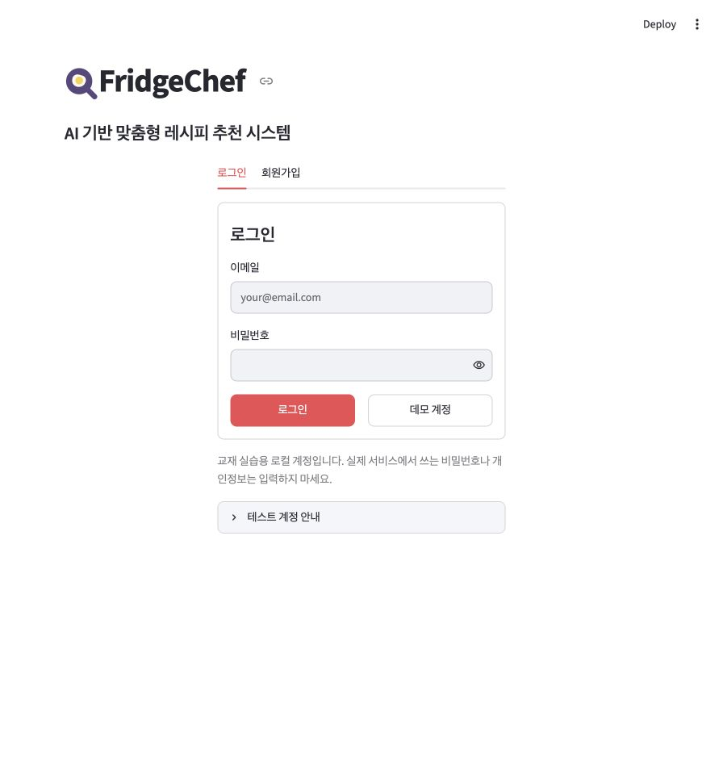
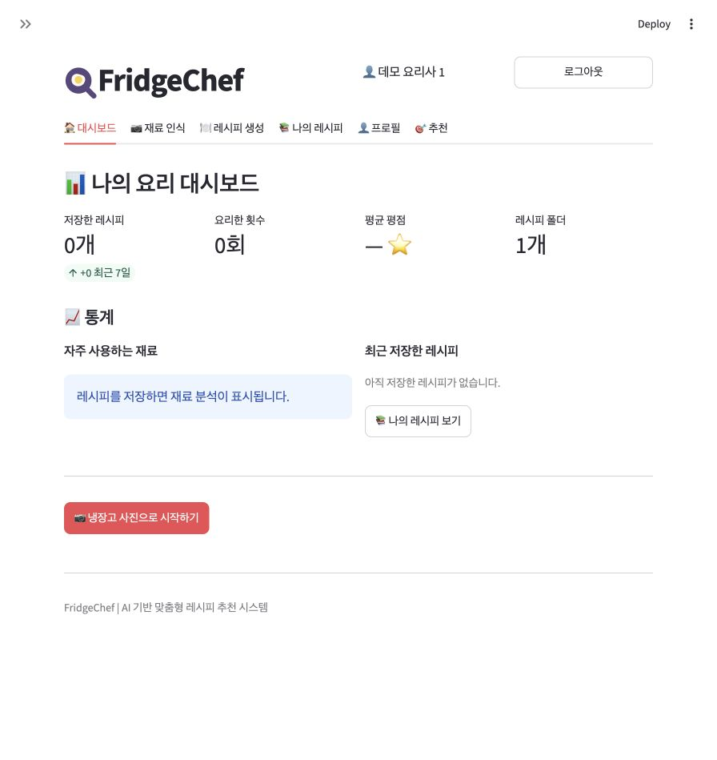
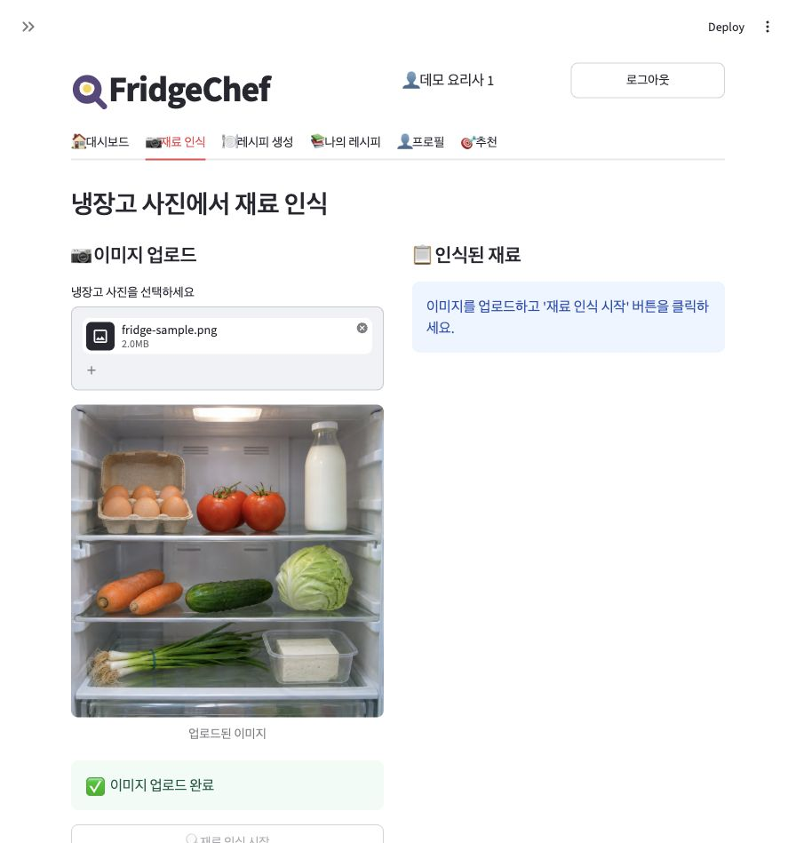
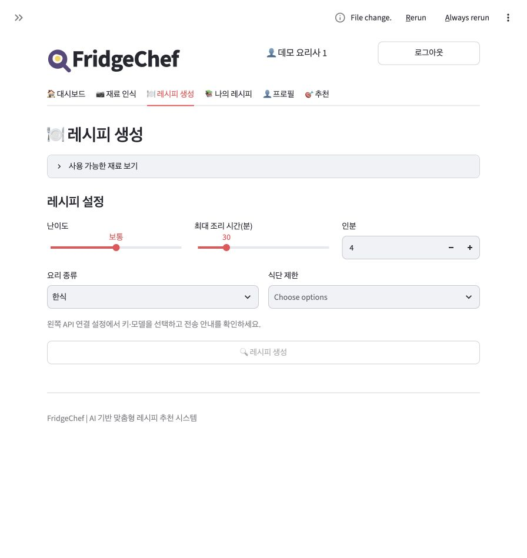

[← Study-03 상식 한 바퀴 퀴즈](../Study-03/SCREENSHOTS.md) · [전체 갤러리로](../SCREENSHOTS.md) · [다음: Study-05 공감 다이어리 →](../Study-05/SCREENSHOTS.md)

# 🍳 Study-04 · FridgeChef 냉장고 요리사

냉장고 사진에서 재료를 인식하고, 그 재료로 만들 수 있는 레시피를 추천·저장하는 AI 앱입니다.

## 한눈에 보기

| 항목 | 내용 |
| --- | --- |
| 분류 | 🤖 AI 앱 · 교재 11–13 |
| 하는 일 | 로그인 → 대시보드 → 사진 인식 → 재료 수정 → 레시피 생성 → 저장 |
| 기술 | Python, Streamlit, Pillow, SQLite, 학교용 FactChat Gateway |
| 실행 방법 | `streamlit run app.py` (Python 환경과 본인의 API 키 필요) |
| 자세한 설명 | [README.md](./README.md) · [13주차 개선 기록](./WEEK13.md) |

### 주요 기능

- **재료 인식:** 사진 업로드와 미리보기, 확인된 재료·불확실한 재료 구분
- **맞춤 레시피:** 난이도·시간·인분·요리 종류·식단 제한 설정
- **결과 확인:** 재료·분량·조리법·예상 시간·추정 칼로리, 검색·필터·JSON 내보내기
- **개인 보관함:** 레시피 저장, 폴더 이동, 중복 저장 방지
- **프로필·대시보드:** 요리 취향, 평점·완료 횟수, 보유 재료 통계
- 교재 13: 리뷰 → 성능 최적화 → UX 개선 서브에이전트로 버그 3건 수정

## 화면 보기

### 1. 로그인

이메일로 만든 로컬 실습 계정 또는 공개 데모 계정으로 들어갑니다.

### 2. 대시보드

저장한 레시피, 평점·완료 횟수, 보유 재료 통계와 추천을 한눈에 봅니다.

### 3. 재료 인식

식재료 사진을 올리면 AI가 확인된 재료와 불확실한 재료를 나눠 보여 주고, 사용자가 수정할 수 있습니다.

### 4. 레시피 설정

난이도·조리 시간·인분·요리 종류·식단 제한을 정한 뒤 레시피를 생성합니다.

> 이 프로젝트는 Python 서버와 API 키가 필요해 GitHub Pages로 바로 실행할 수 없습니다. 위 화면은 과제 진행 중(12–13주차) 로컬에서 캡처한 것입니다.

---

[← Study-03 상식 한 바퀴 퀴즈](../Study-03/SCREENSHOTS.md) · [전체 갤러리로](../SCREENSHOTS.md) · [다음: Study-05 공감 다이어리 →](../Study-05/SCREENSHOTS.md)
