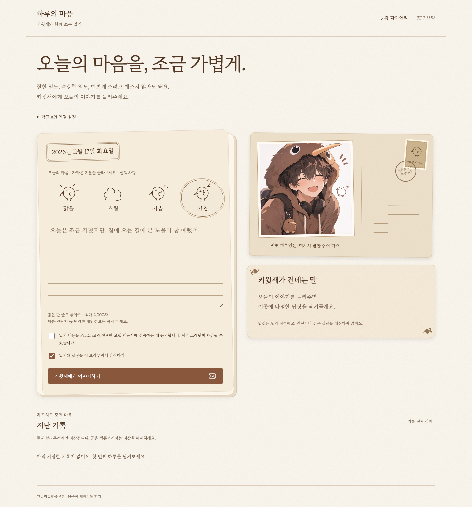

# 14주차 — AI 개발팀과 만드는 두 가지 앱

오늘의 일을 적으면 감정과 공감 메시지를 돌려주는 **공감 다이어리**, PDF에서 글을 추출해 **일반·간단 요약**을 만드는 로컬 웹 앱이다. 교재 14번의 두 예제를 Study-05에 구현한다.

다이어리는 사용자 제공 디자인 참고 이미지의 줄노트·사진 엽서·우표·엽서형 기록을 화면으로 구현했다. 키윗새 원본 그림은 `assets/kiwi-friend.png`에 보관하며 이미지 자체는 수정하지 않았다. 종이 질감과 새 낙서는 SVG·CSS로 표현하고, 글과 버튼은 실제 입력·조작 요소다. 날짜는 한국 시간으로 표시하며 맑음·흐림·기쁨·지침을 선택하면 분석과 기록에 반영한다. 디자인 정리에는 [Damir Sokolovsky (@heydamir)](https://x.com/heydamir)의 unslop 스킬(CC BY 4.0)의 원칙을 참고했다.



[모바일 화면](screenshots/diary-mobile.png)

PDF 요약은 같은 크림·브라운 색상과 마루부리를 사용하되 업무용 문서 도구로 구성했다. 왼쪽에는 파일·요약 설정, 오른쪽에는 넓은 요약 결과를 배치하며 다이어리의 캐릭터·엽서·우표 장식은 사용하지 않는다. [PDF 데스크톱 화면](screenshots/pdf-desktop.png) · [PDF 모바일 화면](screenshots/pdf-mobile.png)

두 앱의 글꼴은 네이버 **마루 부리(MaruBuri)** Regular·SemiBold를 사용한다. 공식 웹폰트 파일을 `assets/fonts/`에 포함해 외부 폰트 서버 연결 없이 제공한다. 원본 출처와 SIL OFL 1.1 전문은 `assets/fonts/LICENSE.txt`에 있다.

## 실행

Python 3.12 이상을 권장한다. `Study-05`에서 실행한다.

```sh
python3 -m venv .venv
.venv/bin/python -m pip install -r requirements.txt
.venv/bin/python server.py
```

Windows에서는 `.venv/bin/python` 대신 `.venv\Scripts\python.exe`를 사용한다.

- 다이어리: http://127.0.0.1:8514/
- PDF 요약: http://127.0.0.1:8514/index_pdf.html

HTML 파일을 직접 열면 API 호출이 동작하지 않는다. 위 서버 주소를 사용한다. 서버를 종료하려면 실행 터미널에서 Ctrl+C를 누른다.

현재 수업 폴더에 이미 있는 환경을 쓰려면 `../Study-04/.venv/bin/python -m pip install -r requirements.txt` 후 `../Study-04/.venv/bin/python server.py`로도 실행할 수 있다. Study-04 코드에 의존하지는 않는다.

## 사용

1. 학교 FactChat 키를 화면에 입력하고 모델 목록을 불러온다. 사용할 텍스트 모델을 직접 선택한다.
2. 전송 안내를 확인하고 동의한다. 모델 목록 조회에는 키를, 분석 요청에는 일기 또는 PDF에서 추출한 텍스트를 학교 API와 모델 제공사에 전송한다. 계정 크레딧이 사용될 수 있다.
3. 다이어리는 2,000자 이내의 일을 적고 감정 분석을 요청한다. 결과는 감정과 공감 메시지로 표시된다. 전문 상담·의료 진단이 아니다.
4. 기록 저장을 선택하면 일기와 분석 결과를 현재 브라우저에 보관한다. 새로고침 후에도 남으며 삭제는 확인 후 실행한다. 공유 컴퓨터에서는 저장을 해제한다.
5. PDF 요약 화면에서는 PDF를 선택하고 일반·간단 요약 중 하나를 고른다. 결과와 페이지·글자 수를 확인하고 중요한 내용은 원문과 대조한다.

## 데이터와 제한

- API 키는 현재 페이지 메모리에만 존재한다. 페이지 이동·새로고침 후 다시 입력한다. `.env` 복사나 키의 코드 삽입은 하지 않는다.
- 서버는 `127.0.0.1:8514`에서만 수신한다. 일기·PDF·키를 서버 파일이나 요청 로그에 저장하지 않는다.
- 브라우저 기록은 암호화 저장소가 아니다. 실제 민감한 일기 대신 수업용 예제로 검사한다.
- PDF 원본은 로컬 서버에서 메모리로 처리하고 추출한 글만 AI에 전달한다. 요약은 서버나 브라우저 기록에 자동 저장하지 않는다.
- PDF는 10MB·100페이지·추출 텍스트 60,000자까지 지원한다. 제한을 넘으면 나누어 입력한다. 암호화 PDF는 암호를 해제하고, 스캔 PDF는 OCR로 글을 추출한 뒤 사용한다. 일부 글이 이미지인 문서는 그 부분이 요약에서 빠질 수 있다.
- 요약은 AI 결과이므로 누락·오류가 있을 수 있다. API 실패 시 이전 정상 결과를 유지한다.

## 구조와 교재 대응

| 파일 | 역할 |
| --- | --- |
| `index.html`, `index_pdf.html` | 교재의 두 앱 진입 화면 |
| `style.css`, `diary.css`, `app.js` | 공통 종이·엽서 화면·API 연결·브라우저 일기 기록 |
| `server.py` | 정해진 앱 파일만 제공하는 로컬 서버·전송 검증 |
| `ai.py` | 학교 FactChat 연결·감정 분석·PDF 추출과 요약 |
| `PRD.md` | 요구사항·역할·완료 기준 |
| `.claude/agents/` | 기획·백엔드·프런트엔드·QA·AI 통합 역할 정의 5개 |
| `TEST_REPORT.md` | 실제 실행한 검사와 미확인 범위 |

교재의 OpenRouter는 기존 수업 환경인 FactChat으로 대체했다. HTML에 비밀 키를 넣지 않기 위해 로컬 Python 서버를 함께 사용하며, 공통 스타일·동작은 두 화면이 공유한다. 새 의존성은 PDF 추출용 pypdf 하나다. 추출 방식은 [pypdf 공식 문서](https://pypdf.readthedocs.io/en/stable/modules/PdfReader.html)를 참고했다.

## 검사

```sh
.venv/bin/python -m unittest discover -v
node --check app.js
node test_frontend.cjs
```

검사는 임시 PDF와 모의 API를 사용한다. 실제 API 연동·브라우저 확인·GitHub 업로드·LMS 제출은 검사 결과와 별도로 기록한다.
