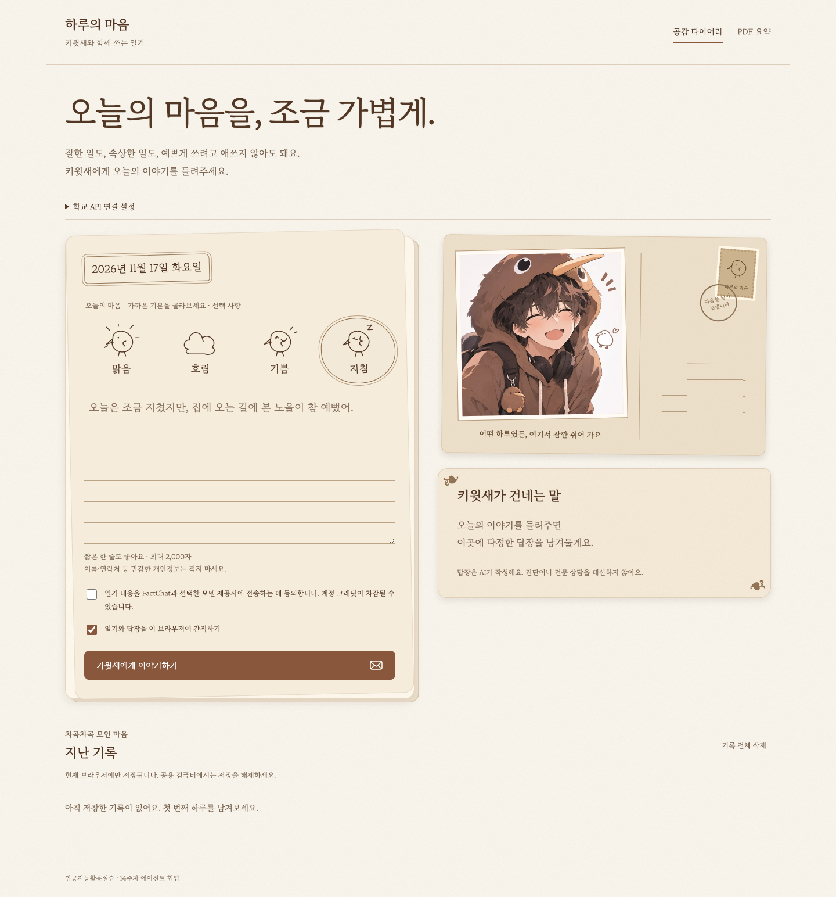
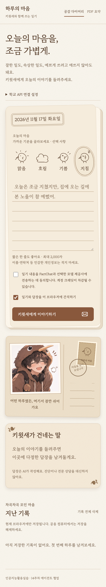
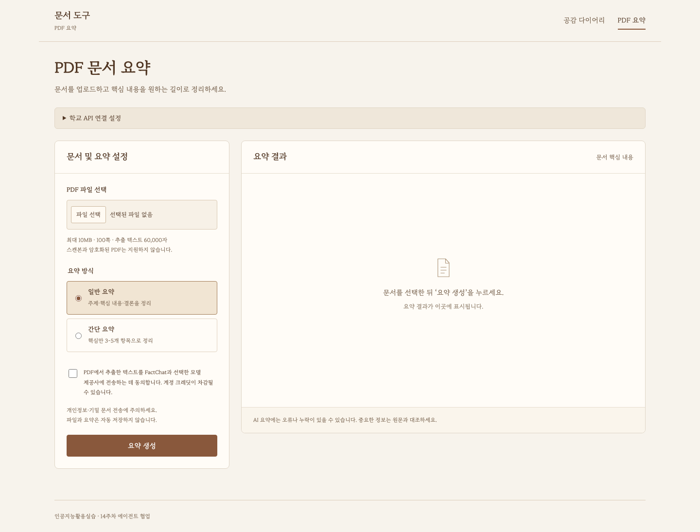
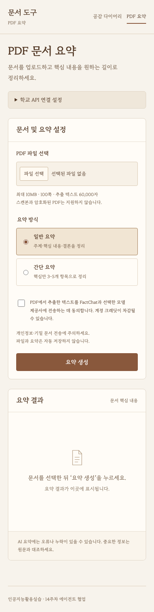

[← Study-04 FridgeChef](../Study-04/SCREENSHOTS.md) · [전체 갤러리로](../SCREENSHOTS.md) · [다음: Study-06 쇼핑 리스트 + MCP →](../Study-06/SCREENSHOTS.md)

# 📔 Study-05 · 공감 다이어리 · PDF 요약

AI 개발팀(서브에이전트 5개)과 함께 만든 두 가지 앱입니다. 일기를 쓰면 감정과 공감 메시지를 돌려주는 다이어리, PDF를 일반·간단 요약하는 문서 도구입니다.

## 한눈에 보기

| 항목 | 내용 |
| --- | --- |
| 분류 | 🤖 AI 앱 · 교재 14 |
| 하는 일 | 일기 감정 분석과 공감 메시지 / PDF 글 추출과 일반·간단 요약 |
| 기술 | Python 로컬 서버, pypdf, HTML·CSS·JavaScript, 학교 FactChat API |
| 실행 방법 | `python server.py` 후 다이어리 `http://127.0.0.1:8514/`, PDF 요약 `/index_pdf.html` (본인의 API 키 필요) |
| 자세한 설명 | [README.md](./README.md) · [테스트 보고서](./TEST_REPORT.md) |

### 주요 기능

- 기획·백엔드·프런트엔드·QA·AI 통합 서브에이전트 5개로 역할을 나눠 개발 ([`.claude/agents/`](./.claude/agents))
- **공감 다이어리:** 날씨·기분 선택, 감정 분석과 공감 메시지, 줄노트·엽서·우표 디자인
- **PDF 요약:** 파일·요약 설정과 넓은 결과 영역을 나눈 업무용 화면
- 네이버 마루 부리 글꼴을 포함해 외부 폰트 서버 없이 제공
- 데스크톱·모바일 반응형 화면

## 화면 보기

### 1. 공감 다이어리 · 데스크톱

오늘의 일을 적고 날씨·기분을 고르면 AI가 감정을 분석하고 공감 메시지를 돌려줍니다.

### 2. 공감 다이어리 · 모바일

### 3. PDF 요약 · 데스크톱

왼쪽에서 PDF와 요약 방식(일반·간단)을 고르면 오른쪽에 요약 결과가 나옵니다.

### 4. PDF 요약 · 모바일

> 이 프로젝트는 Python 서버와 API 키가 필요해 GitHub Pages로 바로 실행할 수 없습니다. 위 화면은 과제 진행 중(14주차) 로컬에서 캡처한 것입니다.

---

[← Study-04 FridgeChef](../Study-04/SCREENSHOTS.md) · [전체 갤러리로](../SCREENSHOTS.md) · [다음: Study-06 쇼핑 리스트 + MCP →](../Study-06/SCREENSHOTS.md)
