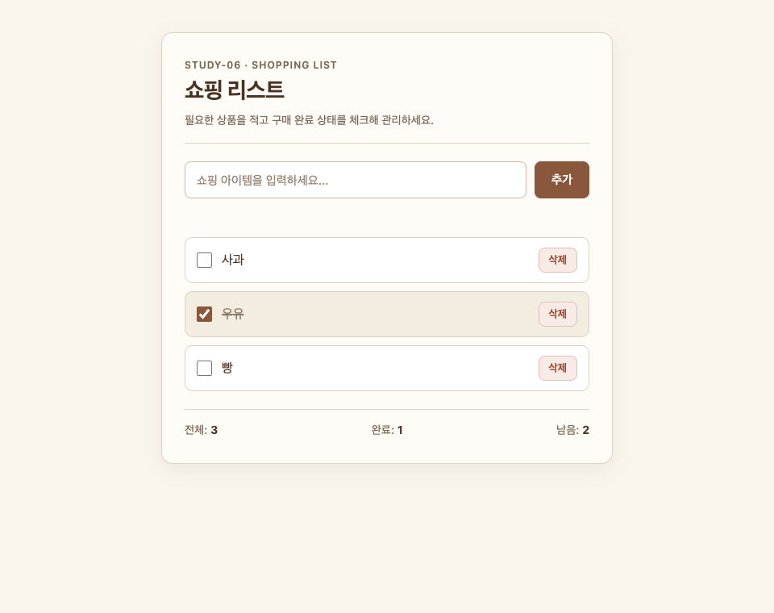

# 15주차 — MCP 연동과 완전 자동화 개발 환경 (`Study-06`)

국립목포대학교 인공지능활용실습 15주차(교재 15·16번 PDF) 실습 결과물입니다. 외부 도구와 문서를 연결하는 **MCP(Model Context Protocol)** 워크플로를 실습하고, API 키 없이 로컬 브라우저에서 바로 동작하는 **쇼핑 리스트 웹 앱(`shopping-list.html`)**을 구현한 뒤 **Playwright MCP**로 자동 검증했습니다.



---

## 1. 실행 방법

### 쇼핑 리스트 웹 앱 실행
별도의 서버, 패키지 설치, API 키 없이 `shopping-list.html` 파일을 브라우저에서 바로 열면 실행됩니다.

```sh
# macOS 터미널에서 바로 열기
open shopping-list.html
```

또는 파일 탐색기(Finder / 탐색기)에서 `Study-06/shopping-list.html`을 더블 클릭해 실행합니다.

### Playwright MCP 자동 검사 다시 실행하기
Node.js(`npx`)와 Python 3가 설치된 환경에서 아래 명령을 실행하면 `@playwright/mcp` 서버를 통해 브라우저 자동 검사와 스크린샷 갱신이 수행됩니다.

```sh
python3 test_shopping_list.py
```

---

## 2. 쇼핑 리스트 주요 기능 (`shopping-list.html`)

- **상품 추가:** 입력창에 상품 이름을 입력하고 `Enter` 키를 누르거나 `[추가]` 버튼을 클릭해 목록에 추가합니다.
- **빈 입력 방지:** 공백만 입력하거나 빈 값으로 추가를 시도하면 추가를 차단하고 안내 메시지를 보여줍니다.
- **구매 완료 체크·해제:** 각 항목의 체크박스를 누르면 취소선과 완료 배경이 적용되고, 다시 누르면 원래 상태로 복구됩니다.
- **개별 상품 삭제:** `[삭제]` 버튼을 누르면 해당 상품만 목록에서 제거되고 나머지 항목은 그대로 유지됩니다.
- **실시간 통계 요약:** 하단 요약 바에서 `전체`, `완료`, `남음` 개수를 즉시 확인할 수 있습니다.
- **안전한 텍스트 표시 및 자동 저장:** 사용자 입력은 HTML로 해석하지 않고 안전하게 텍스트(`textContent`)로만 표시하며, 브라우저 `localStorage`(`study06.shoppingList.v1`)에 자동 저장해 새로고침 후에도 유지됩니다. 저장소 차단이나 손상된 데이터 발생 시에도 화면이 멈추지 않고 안내 메시지를 표시합니다.
- **디자인:** 기존 수업 앱(Study-02~05)의 따뜻한 크림·브라운 색상을 계승하면서 목록 조작에 집중한 간결한 카드 레이아웃으로 구성했습니다.

---

## 3. MCP별 실제 사용 내역

| MCP 도구 | 실제 사용 여부 | 수행 내용 및 결과 |
| --- | --- | --- |
| **Sequential Thinking MCP** (`@modelcontextprotocol/server-sequential-thinking` v2.1.1) | **실제 사용 완료** | 로컬 stdio 서버를 실행해 포트폴리오 체류 시간 2배 전략을 6단계로 추론하고 Step 3에서 초기 가설을 수정(`isRevision: true`)함. 실행 로그는 [`notion-notes/sequential-thinking-mcp-log.json`](notion-notes/sequential-thinking-mcp-log.json)에 보관 |
| **Context7 MCP** (`@upstash/context7-mcp` v4.7.1) | **실제 사용 완료** | 로컬 stdio 서버로 `resolve-library-id`, `query-docs`를 호출해 `/microsoft/playwright` 및 `/microsoft/playwright-mcp` 최신 문서를 실제 조회함 |
| **Playwright MCP** (`@playwright/mcp` v1.66.0-alpha) | **실제 사용 완료** | 격리된 헤드리스 브라우저(`--headless --isolated`)에서 상품 추가, 완료 체크·해제, 개별 삭제, 빈 입력 거부, 새로고침 복원, 저장 실패 처리를 자동 검증하고 `screenshots/`에 캡처 4장을 저장함 |
| **Notion MCP** (`https://mcp.notion.com/mcp`) | **연결·인증 상태 확인 완료 / 원격 저장 미완료** | 원격 Notion MCP 서버 호출 시 사용자 계정의 OAuth 브라우저 인증이 필요함(`HTTP 401`). 인증 전까지 유실되지 않도록 수업용 리서치 노트와 비교 문서 3종을 [`notion-notes/`](notion-notes/)에 작성·보관함 |
| **GitHub 연동** | **기존 인증 재사용 (대체 수행)** | 교재의 신규 저장소(`shopping-list-app`) 생성 및 `.env` PAT 등록 대신, 이미 인증된 Git/GitHub CLI 환경을 재사용해 기존 과제 저장소(`kiwisoop/ai-practice-course`)에 `Study-06`을 반영함 |

---

## 4. Notion 리서치 노트 및 Sequential Thinking 비교 문서

Notion OAuth 인증 전이라 외부 Notion 페이지 URL은 생성되지 않았으며, 수업용으로 새로 작성한 문서 원본을 아래 파일에 정리했습니다.

1. **Claude Code 최신 업데이트 리서치 노트 (확인일: 2026-11-17):**
   - [`notion-notes/01-claude-code-updates.md`](notion-notes/01-claude-code-updates.md)
   - 공식 출처(`anthropics/claude-code` `CHANGELOG.md` v2.1.326 및 공식 MCP 문서) 링크와 최근 변경점 요약 수록
2. **일반 방식 (`체류 시간 늘리기`):**
   - [`notion-notes/02-dwell-time-basic.md`](notion-notes/02-dwell-time-basic.md)
3. **Sequential Thinking MCP 실제 사용 (`체류 시간 늘리기-체계적인 구상`):**
   - [`notion-notes/03-dwell-time-sequential-thinking.md`](notion-notes/03-dwell-time-sequential-thinking.md)
   - MCP 호출 원본 로그: [`notion-notes/sequential-thinking-mcp-log.json`](notion-notes/sequential-thinking-mcp-log.json)
4. **실행 계획·측정 지표·근거 비교 분석:**
   - [`notion-notes/04-comparison-analysis.md`](notion-notes/04-comparison-analysis.md)
   - 분량 차이만으로 우열을 단정하지 않고, 가설 수정(`isRevision`)·기준선(Baseline) 선행 계측·역효과 방지(Guardrail) 지표 유무를 중심으로 비교

---

## 5. 교재 방식과 다른 점

- **저장소 통합 관리:** 교재(16번 PDF)는 `shopping-list-app`이라는 별도 저장소를 새로 만들지만, 이 수업 과제는 3~14주차와 동일하게 [`kiwisoop/ai-practice-course`](https://github.com/kiwisoop/ai-practice-course) 저장소 안의 `Study-06` 폴더로 통합 관리합니다.
- **토큰·민감정보 비저장:** 교재 예시처럼 GitHub PAT나 Context7 API 키를 명령어/설정에 평문으로 남기지 않고, API 키 없이 실행 가능한 로컬 MCP(`@modelcontextprotocol/server-sequential-thinking`, `@upstash/context7-mcp`, `@playwright/mcp`)와 기존 OS 키링의 GitHub 인증을 사용했습니다.
- **격리된 브라우저 검증:** 개인 브라우저 프로필·기록이 노출되지 않도록 Playwright MCP 실행 시 `--isolated` 옵션을 사용해 임시 메모리 프로필에서만 자동 검사를 수행했습니다.

---

## 6. 미완료 항목 및 남은 작업

- **Notion 워크스페이스 직접 업로드:** 사용자 본인의 Notion 계정 OAuth 승인이 필요하므로 원격 Notion 페이지 생성은 미완료 상태입니다. `claude mcp add --transport http notion https://mcp.notion.com/mcp` 등록 후 `/mcp`에서 `Authenticate`를 완료하면 `notion-notes/`의 문서를 바로 업로드할 수 있습니다.
- **LMS 제출 별도 확인:** GitHub 저장소 업로드는 과제 코드·문서 보관이며 학교 LMS 제출 완료를 뜻하지 않습니다.

---

## 7. 폴더 구조

| 파일 / 폴더 | 설명 |
| --- | --- |
| `shopping-list.html` | 쇼핑 리스트 웹 애플리케이션 진입점 (HTML·CSS·JS 단일 파일) |
| `PRD.md` | 15주차 실습 범위·요구사항·자동 검증 기준 |
| `TEST_REPORT.md` | MCP별 실제 사용 내역과 Playwright 자동 검증 상세 보고서 |
| `test_shopping_list.py` | `@playwright/mcp`를 호출해 브라우저 시나리오 6개를 검증하는 자동 검사 스크립트 |
| `screenshots/` | Playwright MCP가 촬영한 단계별 검증 스크린샷 4종 |
| `notion-notes/` | Claude Code 최신 업데이트 요약, 체류 시간 늘리기(일반/체계적 구상), 비교 분석 및 MCP 실행 로그 |
