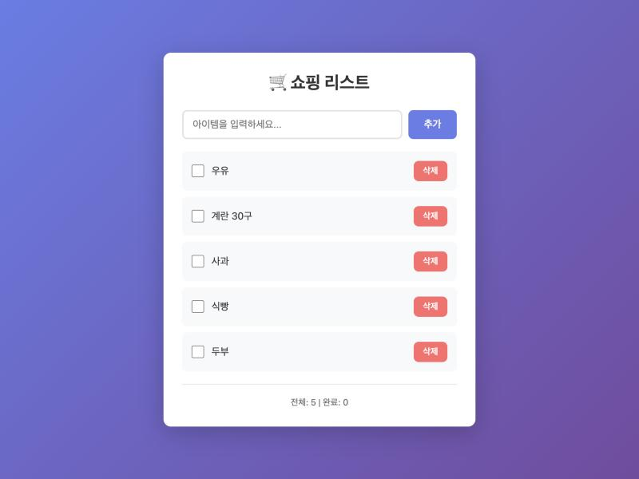
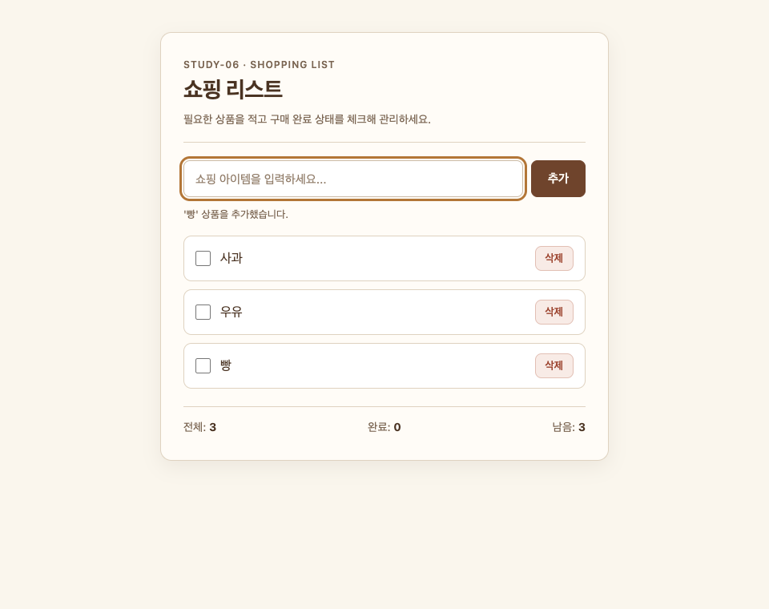
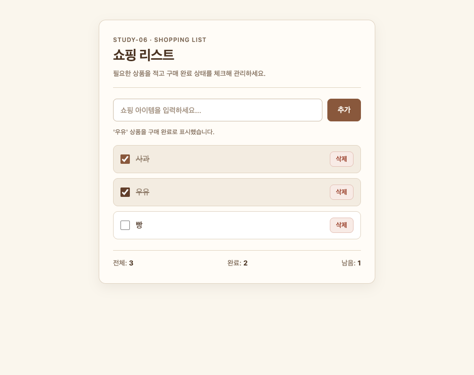
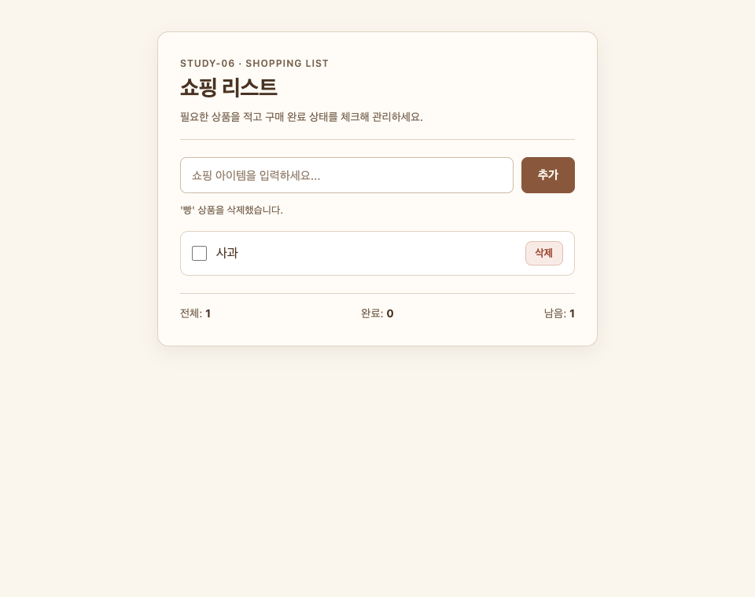
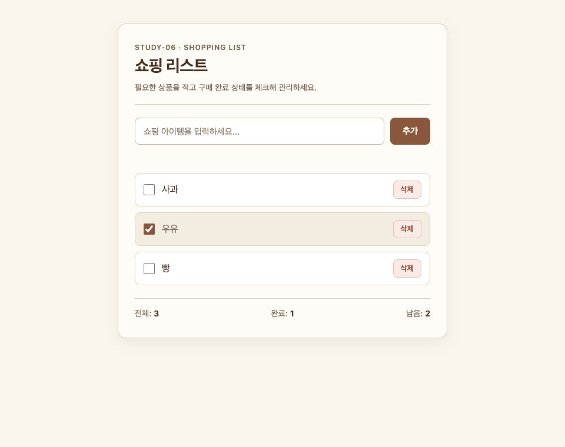

[← Study-05 공감 다이어리](../Study-05/SCREENSHOTS.md) · [전체 갤러리로](../SCREENSHOTS.md)

# 🛒 Study-06 · 쇼핑 리스트 + MCP

MCP 5개(Notion·Sequential Thinking·Context7·Playwright·GitHub)를 Claude Code에 연결해 만들고, 자동으로 검사·문서화·배포한 쇼핑 리스트 앱입니다.

## 한눈에 보기

| 항목 | 내용 |
| --- | --- |
| 분류 | 🌐 웹 · 교재 15–16 |
| 하는 일 | 상품 추가·구매 체크·삭제·집계, Playwright MCP 자동 검사, Notion 문서화, GitHub 저장소 배포 |
| 기술 | HTML, CSS, Vanilla JS, localStorage, MCP |
| 실행 방법 | [▶ 온라인으로 열기](https://kiwisoop.github.io/ai-practice-course/Study-06/claude-code-rerun/shopping-list.html) · 로컬은 `claude-code-rerun/shopping-list.html` |
| 자세한 설명 | [README.md](./README.md) · [Claude Code 실행 기록](./claude-code-rerun/README.md) |

### 주요 기능

- 상품 추가(Enter 또는 추가 버튼), 구매 체크 시 취소선, 개별 삭제
- 전체·완료 개수 집계, 브라우저 자동 저장과 새로고침 복원
- 빈 입력 거부, 입력한 글자를 그대로 안전하게 표시
- Playwright MCP로 추가·체크·삭제 시나리오 자동 검사
- GitHub MCP로 [kiwisoop/shopping-list-app](https://github.com/kiwisoop/shopping-list-app) 저장소 생성·업로드

## 화면 보기

### 1. 처음 연 화면

아직 상품이 없는 빈 목록입니다.

### 2. 상품 추가

우유·계란 30구·사과·식빵·두부 5개를 추가한 화면입니다. 아래에 전체 개수가 표시됩니다.

### 3. 구매 체크

산 상품을 체크하면 취소선이 그어지고 완료 개수가 올라갑니다 (전체 5 · 완료 2).

### 4. 모바일 (375px)

### 5. Playwright MCP 자동 검사 결과

Claude Code가 Playwright MCP로 브라우저를 직접 조작해 검사를 마친 화면입니다.

처음 버전(Codex로 대신한 기록)의 자동 검사 단계별 캡처

| 항목 추가 | 구매 체크 | 삭제 후 |
| :---: | :---: | :---: |
|  |  |  |

> 촬영일 2026-11-25 (1–4번) · 로컬 서버에서 실행해 캡처했습니다. 5번과 접힌 캡처는 과제 진행 중 MCP 자동 검사가 남긴 화면입니다.

---

[← Study-05 공감 다이어리](../Study-05/SCREENSHOTS.md) · [전체 갤러리로](../SCREENSHOTS.md)
