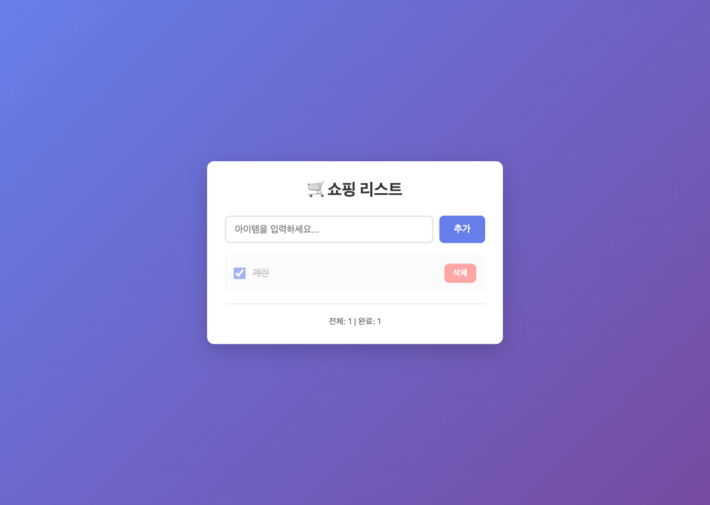

# 교재 15·16 다시 하기 — Claude Code로 직접 실습

처음에는 Codex에 연결된 도구로 대신했던 교재 15·16 실습을 **Claude Code에 MCP를 직접 설치해서** 교재 순서대로 다시 했다. (2026-11-20)

- 결과 저장소: **[kiwisoop/shopping-list-app](https://github.com/kiwisoop/shopping-list-app)** (GitHub MCP로 생성·업로드)
- 이 폴더의 파일은 그 실습에서 Claude Code가 만든 원본 사본이다.
  - `shopping-list.html`: 앱
  - `CLAUDE.md`: `/init` 결과
  - `shopping-list-test.png`: Playwright 스크린샷

## 설치한 MCP

`claude mcp add`(local 범위)로 실습 폴더에 연결하고 `claude mcp list`에서 모두 **✔ Connected**를 확인했다.

| MCP | 연결 방식 |
| --- | --- |
| Notion | 원격 MCP, `/mcp`에서 OAuth 로그인 |
| Sequential Thinking | `npx @modelcontextprotocol/server-sequential-thinking` |
| Context7 | 원격 MCP |
| Playwright | `npx @playwright/mcp@latest` |
| GitHub | 원격 MCP, 개인 토큰은 사용자가 직접 입력 (저장소에 포함하지 않음) |

## 실행 기록

모델: `claude-haiku-4-5`. 프롬프트는 교재 문장을 그대로 썼다.

| 단계 | 교재 프롬프트 | Claude Code가 실제로 호출한 도구 | 결과 |
| --- | --- | --- | --- |
| 16-1 앱 만들기 | 쇼핑 리스트 앱을 만들어 줘. 아이템 추가, 삭제, 체크 기능이 있는 간단한 웹 UI로 로컬 브라우저에서 실행되게 해 줘. | Write 2 · Bash 2 | 한 파일짜리 앱 (localStorage 저장). `index.html`로 만든 것을 `shopping-list.html`로 이름 변경 |
| 16-2 `/init` | `/init` | Read 2 · Glob 1 · Bash 3 · Write 1 | `CLAUDE.md` 생성 |
| 16-3 Playwright | Playwright MCP를 사용해서 이 쇼핑 리스트 앱의 모든 기능을 자동으로 테스트해 줘. … | `browser_navigate` 1 · `browser_type` 3 · `browser_click` 8 · `browser_snapshot` 8 · `browser_take_screenshot` 1 | 우유·계란·소금 추가 → 체크·해제 → 삭제, 통계 갱신 확인 후 스크린샷 |
| 15-1 Notion 리서치 | 클로드 코드의 업데이트, 변경 사항을 검색하고 요약해 줘. 그 결과를 노션 MCP를 이용해 노션에 저장해 줘. | WebSearch 1 · WebFetch 1 · `notion-create-pages` 2 | 업데이트 요약 페이지 저장 |
| 15-2 일반 구상 | 내 웹 포트폴리오 방문자의 체류 시간을 지금의 2배로 늘리고 싶어. … '체류 시간 늘리기'로 저장해 줘. | `notion-create-pages` | '체류 시간 늘리기' 페이지 저장 |
| 15-3 Sequential Thinking | … Sequential Thinking MCP를 이용해서 체계적으로 구상하고 … '체류 시간 늘리기 - 체계적 구상'으로 저장해 줘. | `sequentialthinking` **7회** · `notion-update-page` 1 | 4단계 로드맵 문서로 페이지 갱신 |
| 16-4 GitHub | 현재 폴더에 만들어진 쇼핑 리스트 앱을 깃허브에 저장하고 싶어. github mcp를 사용해서 shopping-list-app이라는 저장소를 만들고 업로드해 줘. | github MCP (저장소 생성 · 파일 업로드 3회) | 공개 저장소에 `shopping-list.html`·`CLAUDE.md`·`README.md` 커밋 3개 |

GitHub 단계는 사용자가 터미널의 대화형 Claude Code에서 도구 사용을 하나씩 승인하며 실행했다.

## 막혔던 부분과 해결

| 문제 | 해결 |
| --- | --- |
| Playwright 도구 권한이 없어 다른 브라우저 도구로 우회하려 함 | Playwright 서버 전체(`mcp__playwright`)를 허용 |
| Playwright MCP가 `file://` 주소를 막음 | `python3 -m http.server`로 로컬 서버를 띄워 `http://127.0.0.1`로 접속 |
| 첫 Sequential Thinking 실행에서 도구 이름을 잘못 불러 단계 없이 문서만 작성 | 도구 이름(`mcp__sequential-thinking__sequentialthinking`)을 명시해 다시 실행, 7단계 호출 확인 |
| GitHub 토큰을 `<토큰>`처럼 꺾쇠까지 넣어 헤더 오류 | 서버를 지우고 꺾쇠 없이 다시 등록 |

## 참고

- Notion 페이지는 개인 워크스페이스에 있어 주소를 공개하지 않는다.
- 15-1 요약은 검색으로 찾은 제3자 사이트를 근거로 했고 공식 문서와 대조하지 않았다.
- 체류 시간 수치(예: +40–50%)는 AI가 세운 가정이며 실험 결과가 아니다.
- 실행 로그 원본(stream-json)은 개인 경로가 들어 있어 올리지 않았다.
