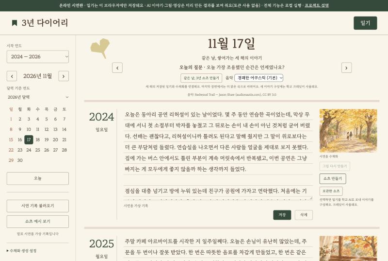
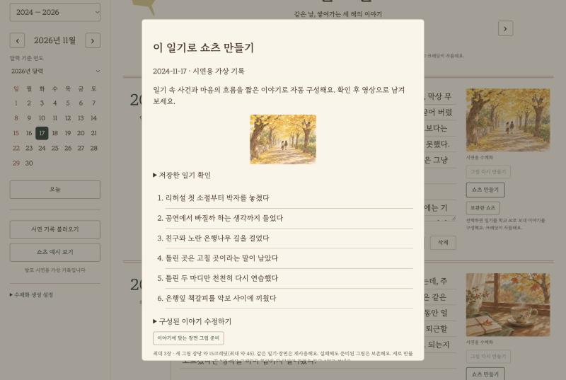
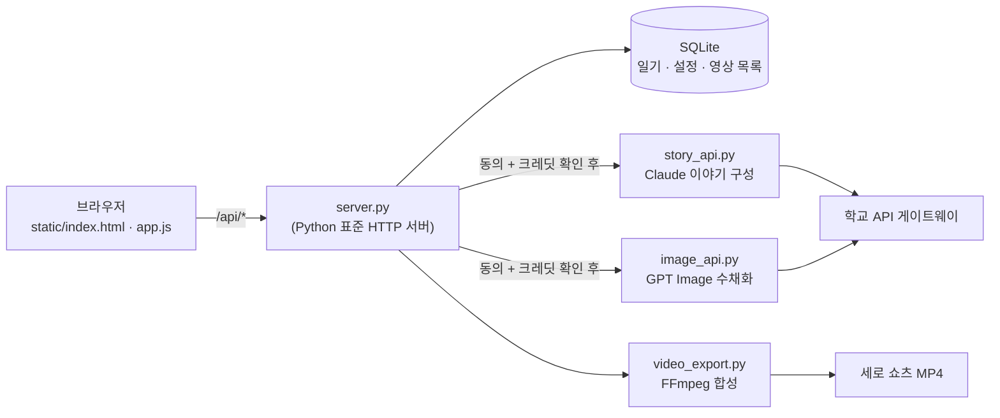
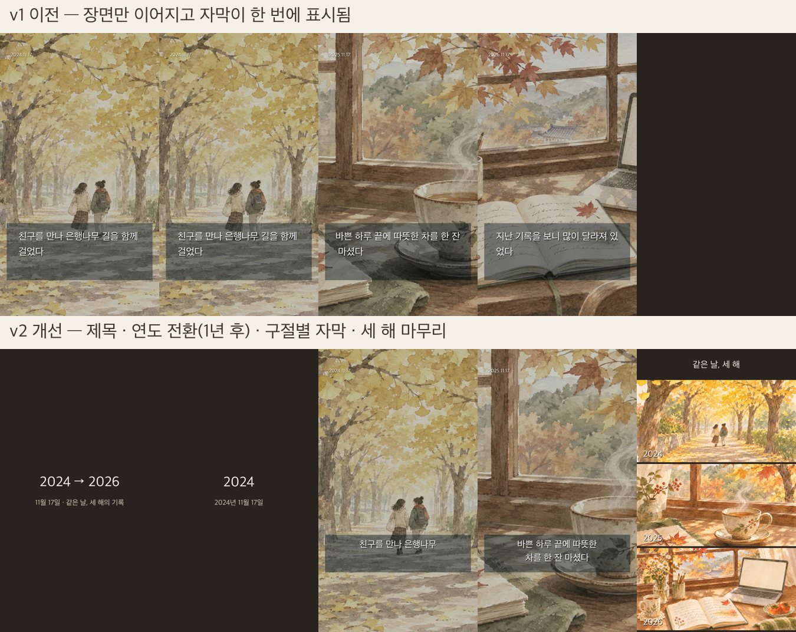

# 3년 다이어리 — 같은 날, 세 해의 이야기

> 같은 날짜의 일기를 3년 동안 한 화면에 쌓고, AI가 그 일기를 **짧은 이야기·수채화·세로 쇼츠 영상**으로 만들어 주는 웹 앱입니다.

**[▶ 온라인 시연판 열기](https://kiwisoop.github.io/ai-practice-course/Term-Project/)** · **[쇼츠 예시 페이지](https://kiwisoop.github.io/ai-practice-course/Term-Project/site/shorts.html)** · 인공지능활용실습 기말 프로젝트



## 이런 결과물을 만듭니다

<table>
  <tr>
    <th>하루 쇼츠 (27초)</th>
    <th>3년 쇼츠 시작 (36.5초 중)</th>
    <th>3년 쇼츠 마무리</th>
  </tr>
  <tr>
    <td></td>
    <td></td>
    <td></td>
  </tr>
</table>

소리가 있는 원본 영상: [하루 쇼츠 MP4](previews/example-day.mp4) · [3년 쇼츠 MP4](previews/example-three-year.mp4)

## 3단계로 보는 사용 흐름

| ① 쓰기 | ② AI가 구성 | ③ 영상으로 남기기 |
|---|---|---|
| 같은 월·일에 세 해의 일기를 나란히 씁니다. 날마다 **오늘의 질문**이 있어 매년 같은 질문에 답하게 됩니다. | AI가 일기를 읽고 **사건과 마음의 흐름을 장면 문장 몇 개**로 정리합니다. 일기로 **수채화**도 그립니다. 사용자는 문장을 직접 고칠 수 있습니다. | 수채화·자막·배경음악에 **자막을 읽어 주는 AI 목소리**까지 더해 **720×1280 세로 쇼츠**를 만들고, 같은 날의 세 해를 **3년 쇼츠** 한 편으로 잇습니다. 완성 영상은 보관됩니다. |



## 확인 포인트

- **주제:** 일기 앱에 "같은 날 3년 비교"와 "일기 → 숏폼 영상"을 결합했습니다. 감정 점수를 매기지 않고 기록 자체를 이야기로 돌려줍니다.
- **AI 활용:** 이야기 구성은 Claude(`claude-sonnet-4-6`), 수채화는 GPT Image(`gpt-image-2.5-sunburst`)를 학교 API로 호출합니다. 호출 전에 동의와 예상 크레딧을 확인하고, 같은 일기는 결과를 다시 써서 중복 비용을 막습니다.
- **구현:** Python 표준 라이브러리 서버, SQLite, 순수 HTML/CSS/JS, FFmpeg 영상 합성으로 만들었습니다. 외부 프레임워크는 쓰지 않았습니다.
- **검증:** 자동 테스트 Python 71개와 Node 프런트엔드 검사가 모두 통과했습니다(임시 DB와 모의 응답 사용). 실제 MP4 출력도 확인했습니다.
- **개발 과정:** Codex가 요구사항 정리·설계·검토를, Claude Code가 구현·테스트를 맡았습니다. 아래 [AI 활용 과정](#ai-활용-과정)에 정리했습니다.

---

# 자세한 설명

## 목차

1. [온라인 시연판과 로컬 실행의 차이](#온라인-시연판과-로컬-실행의-차이)
2. [로컬 실행 방법](#로컬-실행-방법)
3. [주요 기능](#주요-기능)
4. [구조](#구조)
5. [AI 활용 과정](#ai-활용-과정)
6. [AI 비용(토큰) 관리](#ai-비용토큰-관리)
7. [개인정보와 보안](#개인정보와-보안)
8. [테스트와 검증](#테스트와-검증)
9. [폴더 구성](#폴더-구성)
10. [출처와 라이선스](#출처와-라이선스)
11. [한계와 향후 과제](#한계와-향후-과제)

## 온라인 시연판과 로컬 실행의 차이

GitHub Pages는 정적 파일(HTML·CSS·JS·이미지·영상)만 제공합니다. Python 서버, FFmpeg, 학교 AI API는 실행할 수 없습니다. 그래서 온라인 시연판은 **같은 화면과 같은 `app.js`를 쓰고, 서버 API만 브라우저 안에서 흉내 냅니다**([`site/mock-api.js`](site/mock-api.js)).

| 기능 | 온라인 시연판 (github.io) | 로컬 실행 |
|---|---|---|
| 일기 쓰기·수정·삭제, 3년 비교, 오늘의 질문, 임시 글 복구 | ✅ 이 브라우저(localStorage)에만 저장 | ✅ SQLite에 저장 |
| 시연 기록 불러오기 (가상 일기 3편) | ✅ | ✅ |
| AI 이야기 구성 | 시연 기록만 미리 작성한 장면 문장 사용 | ✅ 학교 AI 호출 |
| AI 수채화·장면 그림 | 시연 그림만 표시 | ✅ 학교 AI 호출 |
| 하루·3년 쇼츠 만들기 | 시연 기록만 미리 만든 영상 재생 | ✅ FFmpeg으로 새로 합성 |
| 자막 읽어 주기(AI 음성) | 미리 만든 예시 영상의 목소리만 재생 | ✅ 음성 모델 설치 시 이 컴퓨터에서 생성(크레딧 없음) |
| 학교 AI 토큰 사용 | **없음** | 동의·확인 후 사용 |

시연판 파일은 `static/` 원본에서 자동으로 만듭니다.

```sh
python3 tools/build_site.py   # static/ → site/ (경로 변환 + mock-api.js 연결)
```

## 로컬 실행 방법

준비물은 Python 3.10 이상과 FFmpeg입니다. 외부 Python 패키지는 필요 없습니다.

```sh
git clone https://github.com/kiwisoop/ai-practice-course.git
cd ai-practice-course/Term-Project
cp .env.example .env       # 학교 API 키를 편집기에서 직접 입력 (선택)
python3 server.py
```

브라우저에서 http://127.0.0.1:8766 을 엽니다.

- **API 키 없이도** 일기 쓰기, 시연 기록, 시연 쇼츠는 모두 동작합니다. 키는 새 일기로 AI 이야기·그림을 만들 때만 필요합니다.
- 키를 찾는 순서는 `FACTCHAT_API_KEY` 환경변수 → `Term-Project/.env` → 상위 폴더 `.env`입니다.
- FFmpeg를 찾는 순서는 `FFMPEG` 환경변수 → `ffmpeg-full` → PATH이고, 자막(drawtext)을 그릴 수 있는 빌드를 우선합니다. macOS에서는 `brew install ffmpeg-full`을 권장합니다.
- 한글 글꼴을 찾는 순서는 `DIARY_FONT` → macOS 기본 → 나눔 → Noto CJK → 맑은 고딕입니다.
- **내레이션(선택):** 자막을 목소리로 읽으려면 앱과 별도의 파이썬 환경에 음성 모델을 설치합니다(모델 약 385MB를 Hugging Face에서 받음). 설치하지 않으면 내레이션 선택지가 보이지 않고 나머지는 그대로 동작합니다.

  ```sh
  python3 -m venv .tts/venv
  .tts/venv/bin/pip install supertonic==1.3.1
  .tts/venv/bin/python -c "from supertonic import TTS; TTS(model_dir='.tts/models')"
  ```
- 데이터는 `Term-Project/data/`(SQLite·생성 이미지·영상)에 저장되고 Git에는 올라가지 않습니다.

## 주요 기능

| 영역 | 기능 |
|---|---|
| 일기 | 같은 월·일 3년 세로 비교, 시작 연도 설정, 윤일(2/29)·미래 날짜 검증, 1~10,000자 |
| 쓰기 도우미 | 날짜별 **오늘의 질문**(매년 같은 질문), 지난 해 기록이 있으면 "지난 기록 먼저 읽기" 안내 |
| 안전한 작성 | 브라우저 임시 저장, 새로고침 후 복구, 저장본과 다른 임시 글은 사용자가 고를 때까지 보존 |
| AI 이야기 | 일기 → 1~8개 장면 문장(장면당 64자 이하), 직접 수정 가능, 수정본은 다음 쇼츠에서 재사용 |
| AI 그림 | 일기 → 수채화 1장, 이야기 장면별 그림 최대 3장, 내용이 같으면 재사용 |
| 쇼츠 | 720×1280 세로 영상, 그림 확대·패닝, 구절 단위로 떠오르는 자막, 배경음악 5곡 중 선택 |
| 내레이션 | 장면 자막을 오픈소스 AI 음성(Supertonic 3, F1 목소리)으로 읽어 줌. 장면 길이를 읽는 시간에 맞추고 목소리가 나올 때 음악을 자동으로 줄임. 이 컴퓨터에서 생성해 크레딧이 들지 않으며 켜고 끌 수 있음 |
| 3년 쇼츠 | 제목 카드("2024 → 2026"), "1년 후·2년 후" 연도 카드, 세 해의 수채화가 모이는 마무리 장면, 마무리에서 밝은 곡으로 전환 |
| 보관함 | 완성 영상 보관·재생·MP4 저장, 일기가 바뀌면 "수정 전 일기로 만든 영상" 표시 |

감정 점수·수치·배지는 의도적으로 넣지 않았습니다. 기록을 평가하지 않고 이야기로 돌려주는 것이 목표입니다.

## 구조



| 파일 | 역할 |
|---|---|
| `server.py` | 라우팅, Host/Origin 검사, 일기·이미지·이야기·영상 API, 결과 캐시 |
| `storage.py` | SQLite 저장, 날짜 검증, 시연 기록 적재 |
| `story_api.py` | 일기 → 장면 문장 (형식 검사, 긴 문장 줄이기) |
| `image_api.py` | 수채화·장면 그림 생성 |
| `video_export.py` | 카드·자막·그림 장면 렌더링, 음악 크로스페이드·음량 맞춤, 내레이션 믹스(음악 자동 줄이기), 출처 메타데이터 |
| `narration.py` · `tts_worker.py` | 장면 문장을 로컬 TTS(Supertonic 3 F1)로 읽어 WAV로 캐시. TTS는 별도 파이썬 환경(`.tts/`)에서 실행 |
| `static/` | 화면(HTML/CSS/JS) |
| `site/` | GitHub Pages 시연판 (`tools/build_site.py`로 생성) |

주요 API는 `GET/POST/DELETE /api/diary`, `POST /api/image`, `POST /api/shorts/story`, `POST /api/shorts/scene`, `POST /api/shorts`, `POST /api/three-year-video`, `GET /api/videos`, `GET/POST /api/settings`, `POST /api/demo`입니다.

**캐시:** 이야기와 그림은 일기 본문의 SHA-256 해시로 저장합니다. 같은 일기·같은 장면이면 AI를 다시 부르지 않습니다.

## AI 활용 과정

| 단계 | 담당 | 내용 |
|---|---|---|
| 기획·요구사항 | 사용자 + Codex | 주제 선정, 기능 범위, 감정 수치화 폐기 결정 |
| 설계·검토 | Codex | 구현 계획 작성, 결과 검토, 수정 요청, 협업 기록 관리 |
| 구현·검증 | Claude Code | 코드 작성, 테스트 작성·실행, 오류 수정. ECC 플러그인의 기능 개발 흐름과 코드 리뷰 에이전트 사용 |
| 앱 안의 AI | 학교 API | 이야기 구성 `claude-sonnet-4-6`, 수채화 `gpt-image-2.5-sunburst`(그림 1장 약 15크레딧) |

진행 순서:

1. **v1:** 3년 비교 일기, 수채화, AI 이야기, 하루·3년 쇼츠, 보관함을 구현했습니다.
2. **검증·수정:** 임시 글 충돌, 비용 확인, 수정 자막 재사용 등 검토에서 나온 문제를 고쳤습니다.
3. **v2 (이 폴더):** 3년 쇼츠 제목·연도 카드와 마무리 몽타주, 구절 자막 연출, 오늘의 질문, 배경음악 선택, 자막을 읽어 주는 내레이션(오픈소스 TTS)을 더했습니다. FFmpeg·글꼴 자동 탐지로 다른 컴퓨터에서도 돌아가게 했습니다.
4. **공개:** GitHub Pages 정적 시연판을 만들었습니다.

v1과 v2의 3년 쇼츠 비교(같은 그림·같은 자막):



## AI 비용(토큰) 관리

- **온라인 시연판은 AI를 한 번도 호출하지 않습니다.** 미리 만든 이야기·그림·영상만 보여 주므로, 누가 몇 번을 열어도 토큰이 들지 않습니다.
- **API 키는 로컬 `.env`에만 둡니다.** 브라우저 코드나 저장소에는 키가 없습니다. 정적 사이트에 키를 넣으면 누구나 볼 수 있기 때문입니다.
- **로컬 실행:** 그림을 만들기 전에 동의 체크와 "약 N크레딧" 확인 창을 거치고, 같은 일기는 결과를 다시 씁니다. 장면 그림은 최대 3장입니다.
- **다른 사람이 실행할 때:** 각자 자기 키를 `.env`에 넣고 로컬에서 실행합니다. 키가 없어도 시연 기능은 동작합니다.

## 개인정보와 보안

- 일기 DB·생성 이미지·영상(`data/`)과 `.env`는 `.gitignore`로 제외했습니다. 저장소의 일기는 모두 **가상 시연 기록**입니다.
- 서버는 `127.0.0.1`에서만 열리고, Host·Origin 헤더를 검사해 다른 사이트의 요청을 막습니다.
- 일기 본문은 사용자가 동의한 경우에만 학교 API로 보냅니다.
- 온라인 시연판에 쓴 일기는 그 브라우저에만 남습니다. 서버로 보내지 않고, 브라우저 데이터를 지우면 사라집니다.

## 테스트와 검증

```sh
python3 -m unittest -q      # 71개: 저장·검증·캐시·비용 확인·영상 길이·음악·내레이션·실제 MP4
node test_frontend.cjs      # 임시 글 복구·충돌, 오늘의 질문, 음악·내레이션 선택 등
```

- 테스트는 임시 DB와 모의 AI 응답을 씁니다. 실제 기록과 유료 API를 건드리지 않습니다.
- 상세 결과는 [TEST_REPORT.md](TEST_REPORT.md)에 있습니다.
- 온라인 시연판은 로컬 정적 서버에서 직접 확인했습니다. 시연 기록 불러오기 → 하루 쇼츠 → 3년 쇼츠 → 보관함 순서로 동작했고, 콘솔 오류는 없었습니다.

## 폴더 구성

```
Term-Project/
├─ index.html            # Pages 진입점 → site/ 로 이동
├─ server.py · storage.py · story_api.py · image_api.py · video_export.py · narration.py
├─ static/               # 앱 화면 원본
├─ site/                 # GitHub Pages 시연판 (자동 생성 + mock-api.js)
├─ tools/build_site.py   # 시연판 생성 스크립트
├─ assets/               # 글꼴, 시연 수채화, 배경음악, 출처 문서
├─ previews/             # 예시 쇼츠 MP4·포스터, v1/v2 비교 이미지
├─ docs/images/          # README 캡처·GIF
├─ demo_diaries.json     # 가상 시연 일기 3편 + 미리 쓴 장면 문장
├─ test_*.py · test_frontend.cjs
└─ TEST_REPORT.md
```

## 출처와 라이선스

- **글꼴:** NAVER 마루 부리(MaruBuri). 출처와 라이선스는 [assets/FONT_LICENSE.txt](assets/FONT_LICENSE.txt)에 있습니다.
- **배경음악:** Wikimedia Commons의 CC BY·퍼블릭 도메인 곡 5곡을 씁니다. 작곡가와 라이선스는 [assets/AUDIO_SOURCE.md](assets/AUDIO_SOURCE.md)에 있습니다. 앱 화면·보관함·MP4 메타데이터에도 출처를 표시합니다. 영상을 외부에 올릴 때는 설명란에도 출처를 적어야 합니다.
- **내레이션 음성:** Supertone의 오픈 웨이트 모델 Supertonic 3(F1 목소리, BigScience OpenRAIL-M)을 씁니다. AI 생성 음성임을 밝혀야 하므로 보관함·예시 페이지·MP4 메타데이터에 "AI-generated voice"를 표시합니다. 모델 파일은 저장소에 넣지 않았습니다.
- **시연 수채화:** 학교 이미지 API로 생성했습니다. 시연 일기는 모두 가상으로 작성했습니다.

## 한계와 향후 과제

- 온라인 시연판에서는 새 일기로 AI 이야기·그림·영상을 만들 수 없습니다. 서버와 API 키가 필요해서 로컬 실행에서만 됩니다.
- 시연판의 일기는 브라우저에만 저장되므로 다른 기기와 공유되지 않습니다.
- 배경음악은 곡 설명을 보고 골랐습니다. 실제 분위기는 들어 보고 조정할 예정입니다.
- 폭 720px 이하 화면에서는 달력이 숨겨지고, 날짜는 앞뒤 버튼으로만 이동합니다.
- 내레이션은 로컬에 음성 모델을 설치했을 때만 켤 수 있고, 온라인 시연판에서는 미리 만든 예시 영상의 목소리만 들을 수 있습니다.
- 향후 과제: 모바일 달력 개선, 일기 삭제 시 그 일기로 만든 음성·그림 파일 함께 정리.
