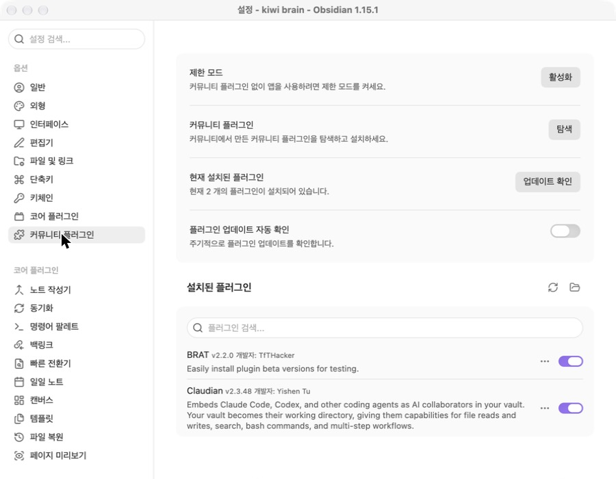
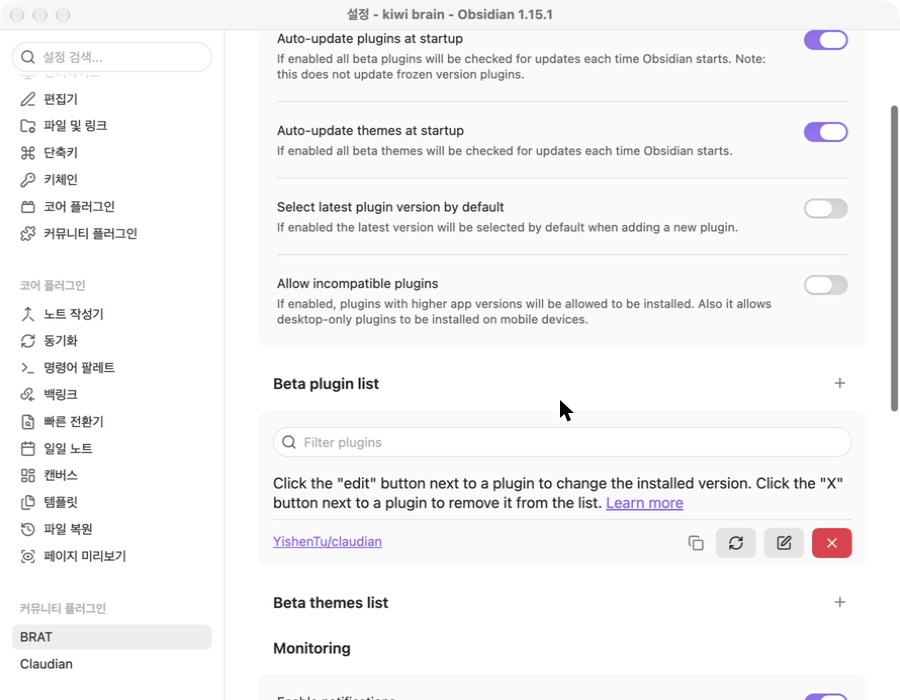
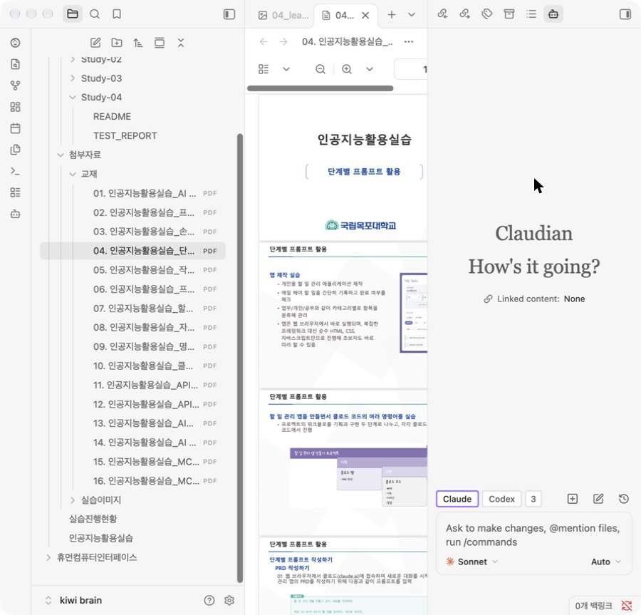
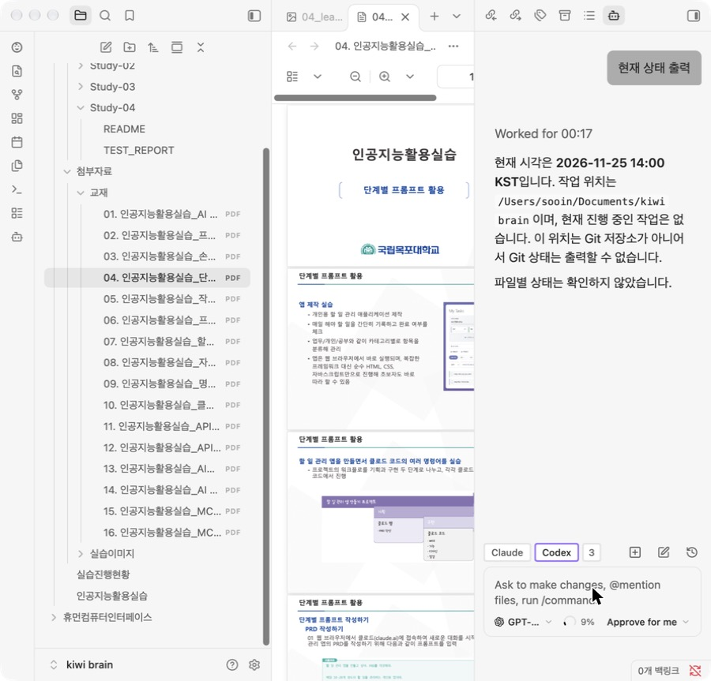

[← 저장소 안내로](../README.md#-교재별-실습-확인표) · [전체 갤러리로](../SCREENSHOTS.md)

# 🪨 교재 10 · Obsidian + Claudian

Obsidian 노트 앱에 BRAT 플러그인으로 Claudian(Obsidian 안에서 Claude Code를 쓰는 플러그인)을 설치하고 연결한 기록입니다. 실습은 개인 Obsidian 볼트에서 진행해 코드 결과물은 없고, 설치·연결 화면을 캡처해 남깁니다.

## 한눈에 보기

| 항목 | 내용 |
| --- | --- |
| 분류 | 🧰 도구 설정 · 교재 10 |
| 한 일 | Obsidian 볼트 준비 → BRAT 설치 → BRAT로 `YishenTu/claudian` 베타 플러그인 추가 → Claudian 패널 열기 → "현재 상태 출력" 실행 |
| 사용한 버전 | BRAT 2.2.0 · Claudian 2.3.48 |
| 결과물 | 아래 화면 캡처 (개인 볼트라 노트 파일은 저장소에 올리지 않음) |

## 화면 보기

### 1. 커뮤니티 플러그인 목록

설정 → 커뮤니티 플러그인에 BRAT와 Claudian 두 개가 설치되어 켜져 있습니다.

### 2. BRAT 베타 플러그인 목록

BRAT 설정의 베타 플러그인 목록에 교재의 주소(`https://github.com/YishenTu/claudian`)로 추가한 Claudian이 있습니다.

### 3. Claudian 패널

오른쪽 사이드바의 로봇 아이콘으로 연 Claudian 대화 패널입니다. 모델은 Claude Sonnet을 선택했습니다.

### 4. "현재 상태 출력" 결과 (Codex)

교재의 첫 프롬프트 "현재 상태 출력"을 보내 Claudian이 볼트 위치와 현재 시각을 읽어 답하는지 확인했습니다. Claude 쪽 사용량 한도가 다 되어, Claudian의 Codex 탭(GPT-6 Sol 모델)으로 실행했습니다.

## 진행 상황

- [x] Obsidian 설치와 볼트 준비
- [x] BRAT 설치, Claudian 베타 플러그인 추가·활성화
- [x] 로봇 아이콘과 Claudian 패널 확인
- [x] "현재 상태 출력" 프롬프트 결과 확인: Claude 모델은 월 사용량 한도 초과(402 `insufficient_quota`)로 답을 받지 못해, 같은 플러그인의 Codex 탭으로 실행해 결과를 받았습니다.
- [ ] 팀 프로젝트 공고(pptx) 분석·발표 자료 만들기(교재 뒷부분): 수업 자료 파일이 볼트에 없어 이 저장소에는 결과가 없습니다.

> 촬영일 2026-11-25 · 개인 Obsidian 볼트에서 캡처했습니다.

---

[← 저장소 안내로](../README.md#-교재별-실습-확인표) · [전체 갤러리로](../SCREENSHOTS.md)
