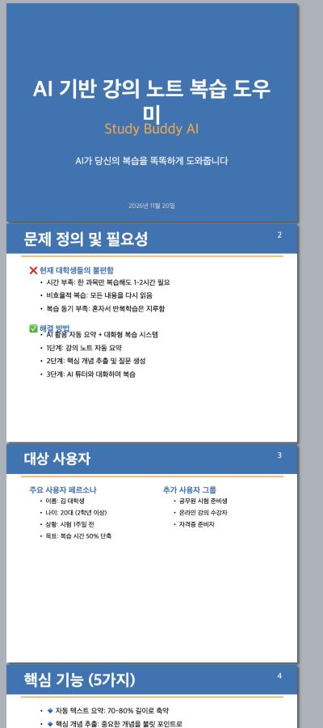
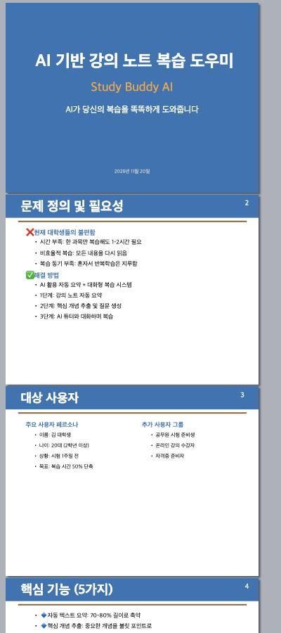

# 교재 10 — 옵시디언 + 클로디언 실습

옵시디언 볼트에서 Claude Code로 텀프로젝트 공고를 분석했다. 이어서 발표 슬라이드 노트와 pptx를 만들고, 결과를 검증해 다시 고치게 했다. (2026-11-20)

| 1차 결과 (v1) | 다시 요청한 뒤 (v2) |
| :---: | :---: |
|  |  |
| 제목이 넘쳐 부제와 겹치고, 2장 소제목이 목록과 겹침 | 겹침 해결. 아래쪽 빈 공간은 남아 있음 |

## 준비

- 옵시디언 볼트에 BRAT 플러그인을 설치하고, BRAT으로 `YishenTu/claudian`을 추가했다.
- 클로디언 패널에서 Claude 연결이 정상임을 확인했다.
- 설정 › 파일 및 링크 › **모든 파일 확장명 인식**을 켰다.
- 볼트에 `생성형AI활용/텀프로젝트` 폴더를 만들고 공고 파일을 넣었다.

## 실행 기록

클로디언은 볼트 폴더에서 Claude Code를 실행하는 플러그인이다. 이번에는 같은 볼트 폴더에서 Claude Code(`claude-haiku-4-5`)를 터미널로 직접 실행했고, 한 대화로 이어 갔다. 만들어진 노트는 옵시디언에 그대로 나타난다.

| 단계 | 프롬프트 | 사용 도구 | 결과 |
| --- | --- | --- | --- |
| 1. 공고 분석 | 공고 파일을 읽은 후 해당 내용을 분석하여 적절한 노트를 생성한 후 기록할 것. 작업에 필요한 라이브러리 및 기타 도구가 있다면 설치하여 사용하고, 분석 및 진행을 기록하기 위한 전용 폴더들도 생성할 것. | Read 1 · Bash 5 · Write 11 | 분석 노트와 진행 가이드, 폴더 4개(`01_프로젝트계획`·`02_AI협업기록`·`03_구현결과물`·`04_평가자료`) |
| 2. 발표 노트 | 텀프로젝트 공고를 만족하는 적절한 주제를 선정하여 5분짜리 발표 자료를 위한 슬라이드 내용을 노트에 작성해. … | Write 2 · Edit 7 | 주제 "AI 기반 강의 노트 복습 도우미", 8장 슬라이드 노트 |
| 3. pptx 작성·검증 | 슬라이드 노트를 바탕으로 제안서 슬라이드를 pptx 파일로 작성해. … 다 만든 후 퀄리티에 문제는 없는지 검증해. | Bash 5 (python-pptx 설치·생성·검증) · Write 3 | `…발표.pptx`. 자체 검증은 "문제 없음" |
| 4. 다시 쓰기 | 슬라이드를 실제로 열어 보니 문제가 있다. (겹침 위치를 구체적으로 적음) … 검증을 확실히 하고 다시 작성해. | Write 5 · Bash 2 | `…발표_v2.pptx`, 위치 기반 검증 스크립트, 개선 기록 노트 |

## 확인한 점

- **자체 검증은 믿을 수 없었다.** 1차 검증은 글자 수와 슬라이드 수만 셌다. 그래서 실제로 겹친 부분을 "문제 없음"으로 보고했다.
- **화면으로 확인하니 문제가 드러났다.** 사람이 미리보기로 슬라이드를 열어 문제 위치를 짚어 주자, Claude가 상자의 위치와 크기로 겹침을 계산하는 검증을 새로 만들었다.
- **"개선됐다"는 말이 다 맞지는 않았다.** v2에서 빈 공간도 개선됐다고 했지만, 화면에는 아래쪽 빈 공간이 여전히 크다. 교재 말대로 한두 번 요청해서는 원하는 결과를 얻기 어렵다.
- **고친 내용은 볼트에 남는다.** 문제와 검증 방법이 `02_AI협업기록/PPTX_레이아웃_개선_기록.md`에 쌓여, 다음 작업에서 다시 참고할 수 있다.

## 교재와 다른 점

| 교재 | 이번 실습 | 이유 |
| --- | --- | --- |
| 클로디언 입력창에 직접 입력 | 같은 볼트 폴더에서 Claude Code를 터미널로 실행 | 이 세션에서는 옵시디언 화면을 조작할 수 없었음. 클로디언 연결은 사용자가 따로 확인함 |
| `T01.생성형AI활용_텀프로젝트 공고.pptx` | `인공지능활용실습_개인_텀프로젝트_공고.pdf` | pptx 공고가 없어 LMS의 PDF 공고를 사용 |
| 수업 슬라이드 pptx를 틀로 내용만 바꾸기 | 노트로 새 pptx 만들기 | 수업 슬라이드는 PDF만 있음 |

공고 PDF는 LMS 배포 자료라 올리지 않았다.

## 파일

- `vault-output/`: 볼트의 `생성형AI활용/텀프로젝트` 폴더 사본(공고 PDF 제외)
- `screenshots/`: Quick Look 미리보기로 연 v1·v2 슬라이드
